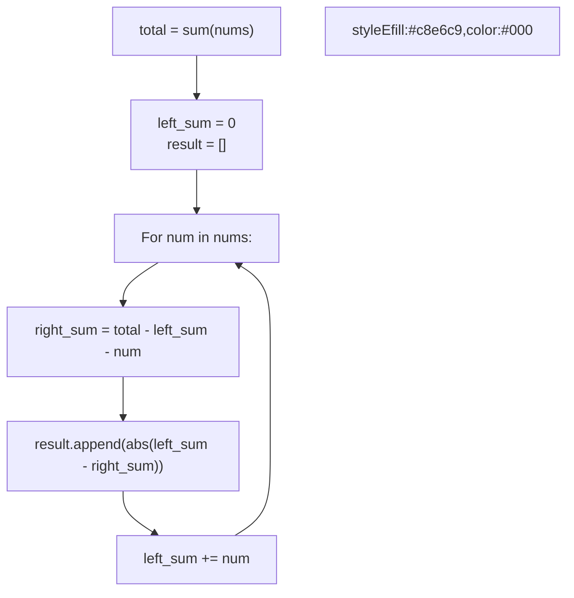

# 🚶‍♂️ Walkthrough: Left and Right Sum Differences

## 👶 Explain Like I'm 5
For every block in a row, figure out the sum of everything to its LEFT, and the sum of everything to its RIGHT. Then, subtract the right sum from the left sum and take the positive difference (absolute value). Return a new array with these differences.

This is almost identical to finding the Middle Index. Instead of checking if left and right are equal, we just subtract them and save the result!

## 🎯 Core Strategy
**Prefix Sum (Total Sum - Left Sum)**.

1. Compute `total_sum` of the entire array.
2. Initialize `left_sum = 0` and an empty `result` list.
3. Iterate through `nums`:
   - `right_sum = total_sum - left_sum - num`
   - Append `abs(left_sum - right_sum)` to `result`.
   - Update `left_sum += num`.
4. Return `result`.

## 🏃‍♂️ Step-by-Step Execution (Dry Run)
**Input**: `nums = [10, 4, 8, 3]`

1. `total_sum = 25`
2. `left_sum = 0`, `result = []`

| i | num | left_sum | right_sum (25 - left - num) | abs(L - R) | result | New left_sum |
|---|---|---|---|---|---|---|
| 0 | 10| 0 | 25 - 0 - 10 = 15 | abs(0 - 15) = 15 | `[15]` | 0 + 10 = 10 |
| 1 | 4 | 10| 25 - 10 - 4 = 11 | abs(10 - 11) = 1 | `[15, 1]` | 10 + 4 = 14 |
| 2 | 8 | 14| 25 - 14 - 8 = 3 | abs(14 - 3) = 11 | `[15, 1, 11]` | 14 + 8 = 22 |
| 3 | 3 | 22| 25 - 22 - 3 = 0 | abs(22 - 0) = 22 | `[15, 1, 11, 22]`| 22 + 3 = 25 |

Return `[15, 1, 11, 22]` ✅

## 📊 Visual Diagram

## 🛑 Complexity
- **Time:** $O(N)$
- **Space:** $O(N)$ for the result array. $O(1)$ auxiliary space.
