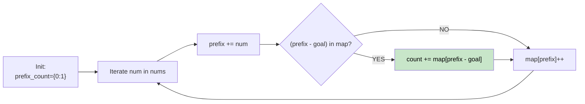

# 🚶‍♂️ Walkthrough: Binary Subarrays With Sum

## 👶 Explain Like I'm 5
You have an array of 0s and 1s, and a `goal` number. Count how many continuous chunks (subarrays) add up to EXACTLY `goal`.

Because the array only contains 1s and 0s, the "sum" of a chunk is simply the number of 1s in it. This is perfectly identical to the "Subarray Sum Equals K" problem where K is the `goal`.

## 🎯 Core Strategy
**Prefix Sum + Hash Map**.

We keep a running sum (`prefix_sum`). As we iterate, if our current sum is $X$, and we want a chunk that sums to `goal`, we need to chop off a prefix that sums to $X - \text{goal}$. 

1. Use a map `prefix_count` to track how many times we've seen each sum so far.
2. Initialize `prefix_count[0] = 1`.
3. For each number:
   - `prefix_sum += num`
   - `count += prefix_count[prefix_sum - goal]`
   - `prefix_count[prefix_sum] += 1`
4. Return `count`.

## 🏃‍♂️ Step-by-Step Execution (Dry Run)
**Input**: `nums = [1, 0, 1, 0, 1]`, `goal = 2`

Init: `map = {0: 1}`, `prefix = 0`, `count = 0`

| num | prefix | needed (pref - 2) | map before | count additions | map updates |
|---|---|---|---|---|---|
| 1 | 1 | -1 | `{0:1}` | map has no -1 | `{0:1, 1:1}` |
| 0 | 1 | -1 | `{0:1, 1:1}` | map has no -1 | `{0:1, 1:2}` |
| 1 | 2 | 0 | `{0:1, 1:2}` | map has 0 (count=1) → `count += 1` | `{0:1, 1:2, 2:1}` |
| 0 | 2 | 0 | `{0:1, 1:2, 2:1}`| map has 0 (count=1) → `count += 1` | `{0:1, 1:2, 2:2}` |
| 1 | 3 | 1 | `{0:1, 1:2, 2:2}`| map has 1 (count=2) → `count += 2` | `{0:1, 1:2, 2:2, 3:1}` |

Total count = 1 + 1 + 2 = 4 ✅

## 📊 Visual Diagram

## 🛑 Complexity
- **Time:** $O(N)$
- **Space:** $O(N)$
