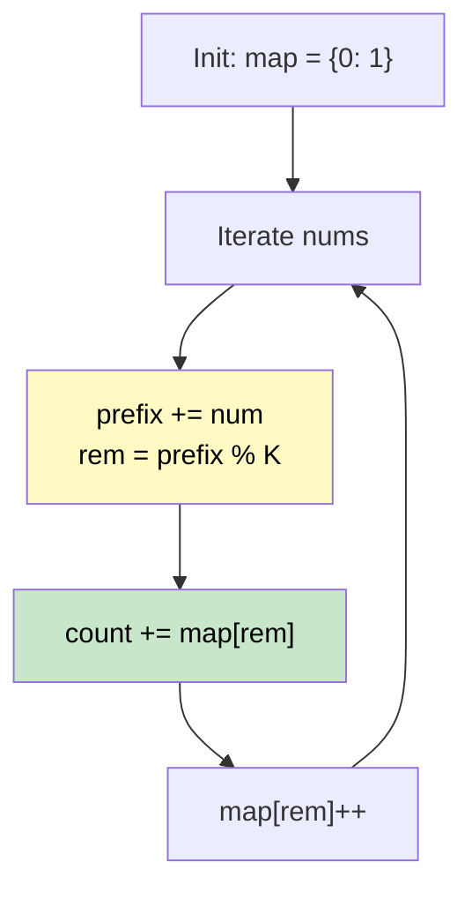

# 🚶‍♂️ Walkthrough: Subarray Sums Divisible by K

## 👶 Explain Like I'm 5
Count how many continuous chunks in an array add up to a number that divides perfectly by `K` (like 0, 5, 10, -5 if `K=5`). 

If two prefix sums have the **exact same remainder** when divided by `K`, the chunk of numbers *between* them must add up to a multiple of `K`! 
For example, if the sum up to index 2 is 14 (remainder 4 when divided by 5), and the sum up to index 6 is 29 (remainder 4), then the sum from index 3 to 6 is $29 - 14 = 15$, which is perfectly divisible by 5!

## 🎯 Core Strategy
**Prefix Sum + Modular Arithmetic Hash Map**.

1. Use a map `remainder_count` to track how many times we've seen each remainder.
2. Initialize `remainder_count[0] = 1` (a remainder of 0 means the prefix itself is divisible by K).
3. Keep a running `prefix_sum`.
4. At each step, find `remainder = prefix_sum % K`.
   *(Note: Python's `%` operator properly handles negative numbers, e.g., `-2 % 5 = 3`)*.
5. Add `remainder_count[remainder]` to our total count.
6. Increment the count of this remainder in the map.

## 🏃‍♂️ Step-by-Step Execution (Dry Run)
**Input**: `nums = [4, 5, 0, -2, -3, 1]`, `K = 5`

Init: `map = {0: 1}`, `prefix = 0`, `count = 0`

| num | prefix | rem (pref % 5) | map before | count additions | map updates |
|---|---|---|---|---|---|
| 4 | 4 | 4 | `{0:1}` | map has no 4 | `{0:1, 4:1}` |
| 5 | 9 | 4 | `{0:1, 4:1}` | map has 4 (count=1) → `+1` | `{0:1, 4:2}` |
| 0 | 9 | 4 | `{0:1, 4:2}` | map has 4 (count=2) → `+2` | `{0:1, 4:3}` |
| -2| 7 | 2 | `{0:1, 4:3}` | map has no 2 | `{0:1, 4:3, 2:1}` |
| -3| 4 | 4 | `{...4:3, 2:1}`| map has 4 (count=3) → `+3` | `{0:1, 4:4, 2:1}` |
| 1 | 5 | 0 | `{0:1, 4:4...}`| map has 0 (count=1) → `+1` | `{0:2, 4:4, 2:1}` |

Total count = 1 + 2 + 3 + 1 = 7 ✅

## 📊 Visual Diagram

## 🛑 Complexity
- **Time:** $O(N)$
- **Space:** $O(K)$ — the map only stores remainders from $0$ to $K-1$.
