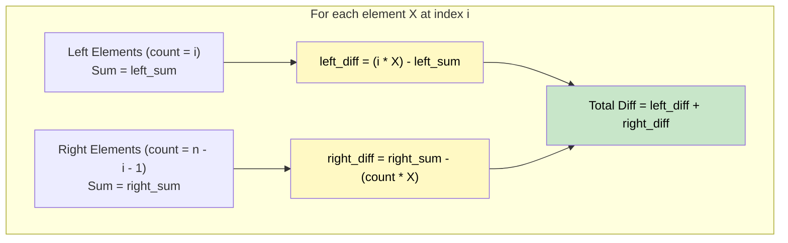

# 🚶‍♂️ Walkthrough: Sum of Absolute Differences in a Sorted Array

## 👶 Explain Like I'm 5
You have a SORTED row of numbers. For every number, you want to calculate how far it is from *every other number* in the row, and add all those distances up.
Doing this normally requires looking at every pair, which is too slow (O(N²)). But because it's sorted, we can use prefix sums to do it instantly!

## 🎯 Core Strategy
**Prefix Sum (Math Optimization)**.

For any element at index `i` (value `X`):
1. All elements to its **left** are $\le X$. So the absolute difference for them is $X - \text{left\_element}$. 
   Sum of left differences = `(i * X) - left_sum`.
2. All elements to its **right** are $\ge X$. So the absolute difference for them is $\text{right\_element} - X$.
   Sum of right differences = `right_sum - (count_of_right_elements * X)`.
3. Total difference for `X` is `left_diff + right_diff`.

## 🏃‍♂️ Step-by-Step Execution (Dry Run)
**Input**: `nums = [2, 3, 5]`
`N = 3`, `total_sum = 10`
`left_sum = 0`

| i | X | right_sum (10 - left - X) | left_diff `(i * X) - left` | right_diff `right - (N-i-1)*X` | Total Diff | New left_sum |
|---|---|---|---|---|---|---|
| 0 | 2 | 10 - 0 - 2 = 8 | (0 * 2) - 0 = **0** | 8 - (2 * 2) = **4** | 0 + 4 = **4** | 0 + 2 = 2 |
| 1 | 3 | 10 - 2 - 3 = 5 | (1 * 3) - 2 = **1** | 5 - (1 * 3) = **2** | 1 + 2 = **3** | 2 + 3 = 5 |
| 2 | 5 | 10 - 5 - 5 = 0 | (2 * 5) - 5 = **5** | 0 - (0 * 5) = **0** | 5 + 0 = **5** | 5 + 5 = 10 |

Result: `[4, 3, 5]` ✅

## 📊 Visual Diagram

## 🛑 Complexity
- **Time:** $O(N)$
- **Space:** $O(N)$ for the result array. $O(1)$ auxiliary memory.
