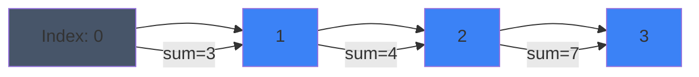

# Pattern 30: Prefix Sum

## 👶 Explain Like I'm 5

Imagine keeping track of your money each day.
- Day 1: +$5 (Total: $5)
- Day 2: +$3 (Total: $8)
- Day 3: -$2 (Total: $6)
- Day 4: +$4 (Total: $10)

If someone asks: "How much did you make from Day 2 to Day 4?"
Instead of adding Day 2 + Day 3 + Day 4, you just take:
`Total at Day 4` MINUS `Total at Day 1` = $10 - $5 = $5.
That's the **Prefix Sum**! By keeping a running total, you can find the sum of ANY
slice (subarray) instantly.

---

## 🧩 Core Idea & Pattern Detection

**Prefix Sum Array**: `prefix[i] = prefix[i-1] + nums[i]`
Sum of subarray `nums[i...j]` = `prefix[j] - prefix[i-1]`.

Often paired with a **Hash Map**:
If we are looking for a subarray that sums to `K`, we know:
`Current_Prefix_Sum - Previous_Prefix_Sum = K`
Which means: `Previous_Prefix_Sum = Current_Prefix_Sum - K`

So we store every `prefix_sum` we see in a hash map. At each step, we just check
if `(current_sum - K)` is already in the hash map!

### When to use it:
- Finding subarrays that sum to a specific target.
- Queries about the sum of elements in a range.
- Arrays containing positive AND negative numbers (where Sliding Window fails).
- Keywords: "subarray sum", "sum equals k", "continuous sequence sum".

---

## 🔧 Visual Anatomy

Finding a subarray summing to `K = 7`:

Current prefix sum at D is `14`. Target `K = 7`.
Does `14 - 7 = 7` exist in our past prefixes? Yes, at index 0 (sum=3 was past prefix, wait... no, if prefix sum at 0 is 3, at D is 14... 14 - 7 = 7. If we saw a prefix sum of 7, the subarray AFTER it up to D sums to 7).

---

## ⏱️ Complexity Analysis

| Operation | Time | Space |
|-----------|------|-------|
| Create Prefix Array | O(N) | O(N) (or O(1) if running sum) |
| Range Sum Query | O(1) | O(1) |
| Find Subarray Sum=K | O(N) | O(N) for Hash Map |

---

## ✅ Problems in This Pattern

| # | Problem | Difficulty | LeetCode |
|---|---------|------------|----------|
| 1 | Subarray Sum Equals K | Medium | #560 |
| 2 | Max Size Subarray Sum Equals K | Medium | #325 |
| 3 | Contiguous Array (Equal 0s and 1s) | Medium | #525 |
| 4 | Range Sum Query 2D - Immutable | Medium | #304 |
| 5 | Path Sum III (Tree + Prefix Sum) | Medium | #437 |
