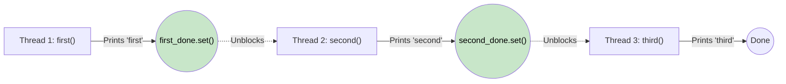

# 🚶‍♂️ Walkthrough: Print in Order

## 👶 Explain Like I'm 5
Imagine you have three tasks: A, B, and C. You want them to finish in that exact order (A -> B -> C), but you hired three different workers who all start at the same time and do things at their own speed. 

How do you force them into order? You give worker B a red light that only turns green when A finishes. You give worker C a red light that only turns green when B finishes!

## 🎯 Core Strategy
**Threading Events (`threading.Event`)**.

An Event is exactly like a traffic light. 
- It starts red (cleared). Threads wait (`event.wait()`) until it turns green.
- Someone else can turn it green by setting it (`event.set()`).

1. Create `first_done` and `second_done` events.
2. `second()` waits on `first_done` before doing its work. Once done, it sets `second_done`.
3. `third()` waits on `second_done` before doing its work.
4. `first()` just does its work, then sets `first_done` to let `second()` start.

## 🏃‍♂️ Step-by-Step Execution (Dry Run)
Suppose the OS schedules thread 3 (running `third()`) to go first, then thread 2, then thread 1.

| Time | Thread 1 (first) | Thread 2 (second) | Thread 3 (third) |
|---|---|---|---|
| t=1 | (not scheduled yet) | (not scheduled yet) | `second_done.wait()` 🔴 (Blocked) |
| t=2 | (not scheduled yet) | `first_done.wait()` 🔴 (Blocked) | (Still blocked) |
| t=3 | Prints "first" ✅ | (Still blocked) | (Still blocked) |
| t=4 | `first_done.set()` 🟢 | Wakes up! Prints "second" ✅ | (Still blocked) |
| t=5 | (Done) | `second_done.set()` 🟢 | Wakes up! Prints "third" ✅ |
| t=6 | (Done) | (Done) | (Done) |

Output: "firstsecondthird" ✅

## 📊 Visual Diagram

## 🛑 Complexity
- **Time:** $O(1)$ — each thread does $O(1)$ work.
- **Space:** $O(1)$ — just two event objects.
