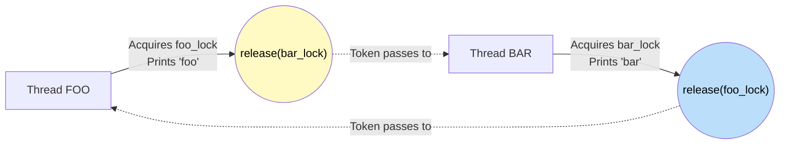

# 🚶‍♂️ Walkthrough: Print FooBar Alternately

## 👶 Explain Like I'm 5
Two workers need to take turns endlessly. Worker 1 prints "foo", Worker 2 prints "bar". They have to alternate perfectly: "foo bar foo bar...".

They pass a single "talking stick" back and forth. You can only speak if you have the stick. Worker 1 starts with the stick.

## 🎯 Core Strategy
**Semaphores**.

A semaphore is a lock with a counter (tokens). If the counter is 0, anyone trying to take a token (`acquire`) must wait until someone adds a token (`release`).

1. `foo_lock = Semaphore(1)`: Starts with 1 token (green light for foo).
2. `bar_lock = Semaphore(0)`: Starts with 0 tokens (red light for bar).
3. **Foo Thread**: 
   - `acquire` foo_lock (takes the 1 token, leaving 0).
   - Print "foo".
   - `release` bar_lock (adds 1 token, waking up bar).
4. **Bar Thread**: 
   - `acquire` bar_lock (waits for foo to give it a token).
   - Print "bar".
   - `release` foo_lock (gives the token back to foo).

## 🏃‍♂️ Step-by-Step Execution (Dry Run)
**Loop count N = 2**

| Thread Foo | Thread Bar | foo_lock | bar_lock | Output |
|---|---|---|---|---|
| (init) | (init) | 1 | 0 | (empty) |
| `foo_lock.acquire()` ✅ | `bar_lock.acquire()` 🔴 (waits) | 0 | 0 | |
| Print "foo" | (waiting) | 0 | 0 | "foo" |
| `bar_lock.release()` | wakes up! ✅ | 0 | 1 -> 0 | |
| Loop 2: `foo_lock.acquire()` 🔴 | Print "bar" | 0 | 0 | "foo bar" |
| (waiting) | `foo_lock.release()` | 1 -> 0 | 0 | |
| wakes up! ✅ | (done) | 0 | 0 | |
| Print "foo" | | 0 | 0 | "foo bar foo" |
| `bar_lock.release()` | | 0 | 1 | |
| (done) | (done) | 0 | 1 | "foo bar foo" (Wait, bar still needs to run once more!) |

*Correction for last step*: Foo prints "foo", releases `bar_lock`. Bar (which was waiting or about to loop) acquires `bar_lock`, prints "bar", releases `foo_lock`. Done!
Final Output: "foobarfoobar" ✅

## 📊 Visual Diagram

## 🛑 Complexity
- **Time:** $O(N)$
- **Space:** $O(1)$
