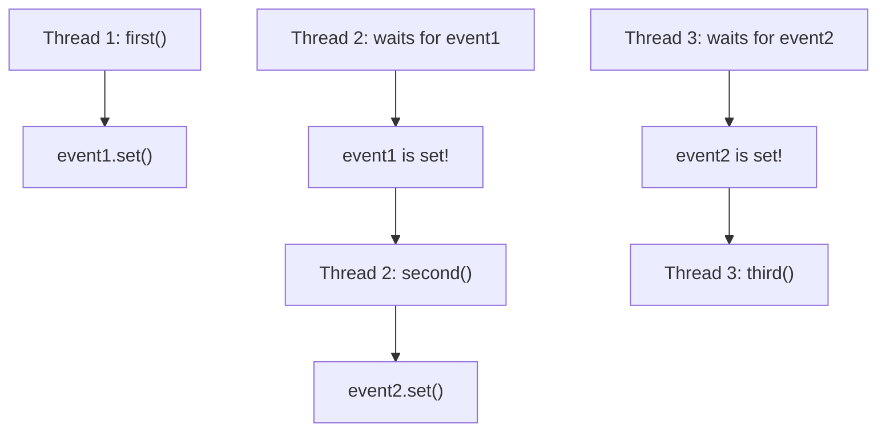

# Pattern 31: Multi-threaded / Concurrency

## 👶 Explain Like I'm 5

Imagine three chefs in a kitchen making a burger.
Chef 1 cooks the meat, Chef 2 puts it on a bun, Chef 3 adds the sauce.
They are all working at the exact same time (**multi-threading**).
But wait! Chef 3 cannot add sauce if Chef 2 hasn't put the meat on the bun yet.
And Chef 2 cannot do his job until Chef 1 finishes cooking the meat.
We need **Locks and Signals** to force them to wait their turn!

---

## 🧩 Core Idea & Pattern Detection

Multi-threading is about orchestrating multiple threads of execution so they don't
step on each other's toes (Race Conditions) and execute in a specific order (Synchronization).

### Python Concurrency Tools (`threading` module):
- **Lock**: Only one thread can hold it. Others must wait to acquire it.
- **Event**: A boolean flag. Threads can `wait()` until another thread calls `set()`.
- **Semaphore**: A counter. If counter > 0, thread acquires and decrements. If 0, it waits. Great for "allow exactly N threads".
- **Condition**: A lock combined with an event. Wait for a specific condition to be true.
- **Barrier**: Wait for exactly N threads to reach a point before letting them all go.

### When to use it:
- Parallel execution of tasks.
- Forcing sequence across independent threads (e.g., "Thread B must run after Thread A").
- Keywords: "Print in Order", "Alternately", "Multi-threaded", "Synchronize".

---

## 🔧 Visual Anatomy

Using `Event` to force ordering:

---

## ⏱️ Complexity Analysis

| Mechanism | Speed | Use Case |
|-----------|-------|----------|
| **Lock** | Fast | Mutual exclusion (prevent race conditions) |
| **Event** | Fast | One-way signaling ("I am done, you can start") |
| **Semaphore** | Fast | Resource counting ("Only 2 threads at a time") |
| **Condition**| Medium| Complex state coordination (Producer/Consumer) |

*(Note: Python's Global Interpreter Lock (GIL) prevents true parallel execution of CPU-bound threads, but IO-bound or sleeping threads switch context perfectly. For interviews, we only care about the logical synchronization).*

---

## ✅ Problems in This Pattern

| # | Problem | Difficulty | LeetCode |
|---|---------|------------|----------|
| 1 | Print in Order | Easy | #1114 |
| 2 | Print FooBar Alternately | Medium | #1115 |
| 3 | Print Zero Even Odd | Medium | #1116 |
| 4 | Building H2O | Medium | #1117 |
