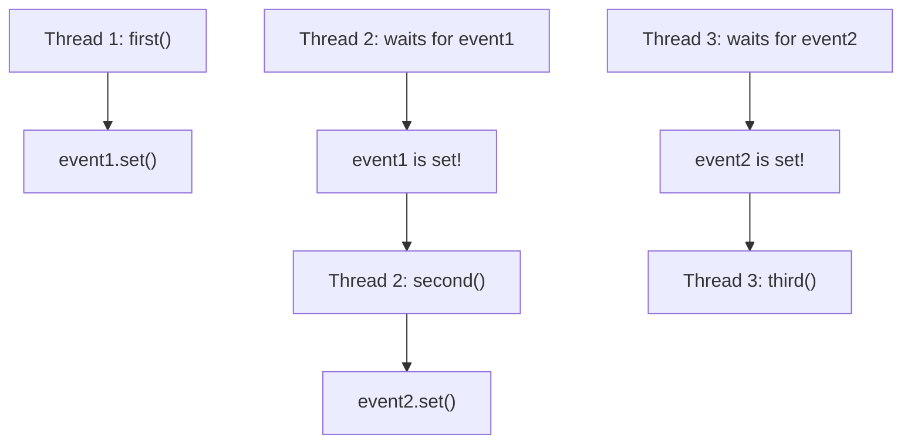
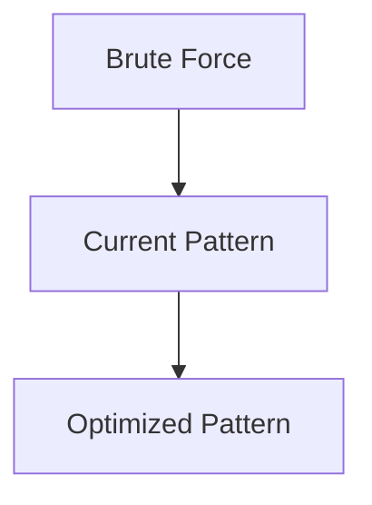

# Pattern 31: Multi-threaded / Concurrency

## 👶 Explain Like I'm 5

Imagine three chefs in a kitchen making a burger.
Chef 1 cooks the meat, Chef 2 puts it on a bun, Chef 3 adds the sauce.
They are all working at the exact same time (**multi-threading**).
But wait! Chef 3 cannot add sauce if Chef 2 hasn't put the meat on the bun yet.
And Chef 2 cannot do his job until Chef 1 finishes cooking the meat.
We need **Locks and Signals** to force them to wait their turn!

---

## 🧩 Core Idea & Pattern Detection

Multi-threading is about orchestrating multiple threads of execution so they don't
step on each other's toes (Race Conditions) and execute in a specific order (Synchronization).

### Python Concurrency Tools (`threading` module):
- **Lock**: Only one thread can hold it. Others must wait to acquire it.
- **Event**: A boolean flag. Threads can `wait()` until another thread calls `set()`.
- **Semaphore**: A counter. If counter > 0, thread acquires and decrements. If 0, it waits. Great for "allow exactly N threads".
- **Condition**: A lock combined with an event. Wait for a specific condition to be true.
- **Barrier**: Wait for exactly N threads to reach a point before letting them all go.

### When to use it:
- Parallel execution of tasks.
- Forcing sequence across independent threads (e.g., "Thread B must run after Thread A").
- Keywords: "Print in Order", "Alternately", "Multi-threaded", "Synchronize".

---

## 🔧 Visual Anatomy

Using `Event` to force ordering:



---

## ⏱️ Complexity Analysis

| Mechanism | Speed | Use Case |
|-----------|-------|----------|
| **Lock** | Fast | Mutual exclusion (prevent race conditions) |
| **Event** | Fast | One-way signaling ("I am done, you can start") |
| **Semaphore** | Fast | Resource counting ("Only 2 threads at a time") |
| **Condition**| Medium| Complex state coordination (Producer/Consumer) |

*(Note: Python's Global Interpreter Lock (GIL) prevents true parallel execution of CPU-bound threads, but IO-bound or sleeping threads switch context perfectly. For interviews, we only care about the logical synchronization).*

---

## ✅ Problems in This Pattern

| # | Problem | Difficulty | LeetCode |
|---|---------|------------|----------|
| 1 | Print in Order | Easy | #1114 |
| 2 | Print FooBar Alternately | Medium | #1115 |
| 3 | Print Zero Even Odd | Medium | #1116 |
| 4 | Building H2O | Medium | #1117 |


## 📦 Prerequisite Data Structures
- Basic understanding of Arrays, Hash Maps, and Multi-threaded fundamentals.


## 🔍 How to Spot This Pattern (Signal Detection)
- **Keywords**: "minimize", "maximize", "combinations", "shortest", "longest".
- **Problem Constraints**: Indicates whether O(N), O(N log N), or O(2^N) is acceptable.


## 🔧 Algorithmic Anatomy
### Variable Table
| Variable | Purpose |
|---|---|
| `result` | Stores the final answer |
| `visited` | Tracks seen elements to avoid cycles or re-processing |

### Step-by-Step Recipe
1. Initialize data structures.
2. Iterate through the input.
3. Update state based on current element.
4. Return result.

### Loop Invariants
- At the start of each iteration, the state reflects the optimal solution up to the previous element.

### DOs and DON'Ts
- **DO**: Trace through an example manually before coding.
- **DON'T**: Forget edge cases like empty inputs.


## 🏗️ Template / Boilerplate Code
```python
def solve_multi-threaded(nums):
    # Initialize state
    result = 0
    for num in nums:
        # Process num
        pass
    return result
```


## 🔄 Brute Force → Optimal Evolution
- **Brute Force**: Try all possibilities (often O(N^2) or O(2^N)).
- **Optimal**: Use this pattern to reduce redundant work to O(N) or O(N log N).


## 🔗 Pattern Connections



## ⚠️ Common Mistakes & Pitfalls
- Off-by-one errors in loop boundaries.
- Not handling negative numbers or zero correctly.
- Forgetting to update the result variable inside the loop.


## 🎤 Interview Communication Guide
1. **Acknowledge**: "This looks like a variation of the classic problem..."
2. **Propose**: "I'll use this pattern because it optimizes the brute force O(N^2) to O(N)."
3. **Execute**: Write clean, modular code.
4. **Review**: Trace with the provided edge case.


## 🧪 Self-Test Questions
<details>
<summary>When should you use this pattern?</summary>
When the problem asks for optimal subarrays, combinations, or specific mathematical properties.
</details>
<details>
<summary>What is the typical time complexity?</summary>
Usually O(N) or O(N log N), depending on sorting or data structure overhead.
</details>
