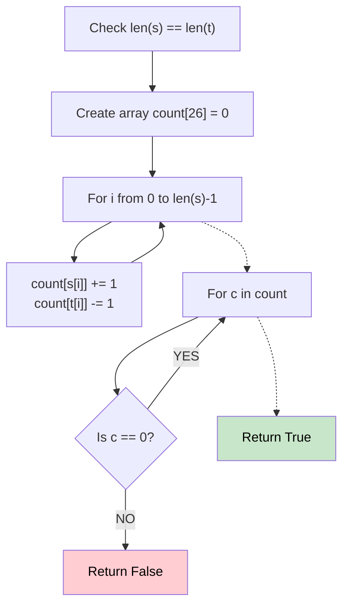

# 🚶‍♂️ Walkthrough: Valid Anagram

## 👶 Explain Like I'm 5
Two words are "anagrams" if they are made of the exact same letters, just mixed up. For example, "silent" and "listen".
To check this, you could count how many times each letter appears in the first word, and then subtract that count as you look at the letters in the second word. If you end up with exactly zero for every letter, they are anagrams!

## 🎯 Core Strategy
**Array Frequency Count**.

1. Check if the strings have the same length. If not, they can't be anagrams.
2. Create an array `count` of size 26 (since there are 26 lowercase English letters).
3. Loop through the strings (using one loop since they are the same length):
   - For `s`, **add 1** to the count of that letter.
   - For `t`, **subtract 1** from the count of that letter.
4. Finally, loop through the `count` array. If any number is not 0, return `False`.
5. If all are 0, return `True`.

## 🏃‍♂️ Step-by-Step Execution (Dry Run)
**Input**: `s = "rat"`, `t = "car"`

| i | s[i] | t[i] | Count Array Updates |
|---|---|---|---|
| 0 | r | c | `count['r'] += 1`, `count['c'] -= 1` |
| 1 | a | a | `count['a'] += 1`, `count['a'] -= 1` |
| 2 | t | r | `count['t'] += 1`, `count['r'] -= 1` |

Count Array after loop:
`c = -1`
`t = 1`
`a = 0`
`r = 0`

Because some counts are not 0 (e.g., `c` is -1), return `False` ❌

## 📊 Visual Diagram

## 🛑 Complexity
- **Time:** $O(N)$ — One pass through the strings.
- **Space:** $O(1)$ — Array is always size 26, which is constant.
