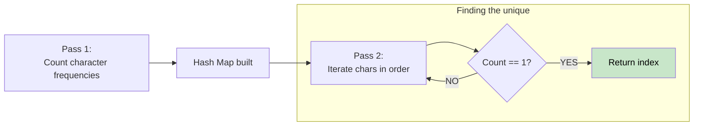

# 🚶‍♂️ Walkthrough: First Unique Character in a String

## 👶 Explain Like I'm 5
Find the first letter in a word that only appears ONCE.
You just walk through the word and count how many times you see each letter. Then, you walk through the word a second time, and the very first letter you see that has a count of "1" is your answer!

## 🎯 Core Strategy
**Hash Map Frequency Count (Two Passes)**.

1. **First Pass:** Iterate through the string and count the frequency of each character using a Hash Map (or `collections.Counter` in Python).
2. **Second Pass:** Iterate through the string *again* (from left to right, preserving order).
3. Check the count of the current character. If it equals 1, return the current index!
4. If you finish the loop without finding any count of 1, return -1.

## 🏃‍♂️ Step-by-Step Execution (Dry Run)
**Input**: `s = "loveleetcode"`

**First Pass** (Count Frequencies):
`counts = {'l': 2, 'o': 2, 'v': 1, 'e': 4, 't': 1, 'c': 1, 'd': 1}`

**Second Pass** (Find first with count == 1):

| i | char | counts[char] | Action |
|---|---|---|---|
| 0 | l | 2 | Continue |
| 1 | o | 2 | Continue |
| 2 | v | 1 | **Return 2** ✅ |

## 📊 Visual Diagram

## 🛑 Complexity
- **Time:** $O(N)$ — Two linear passes through the string.
- **Space:** $O(1)$ — The hash map stores at most 26 lowercase English letters.
