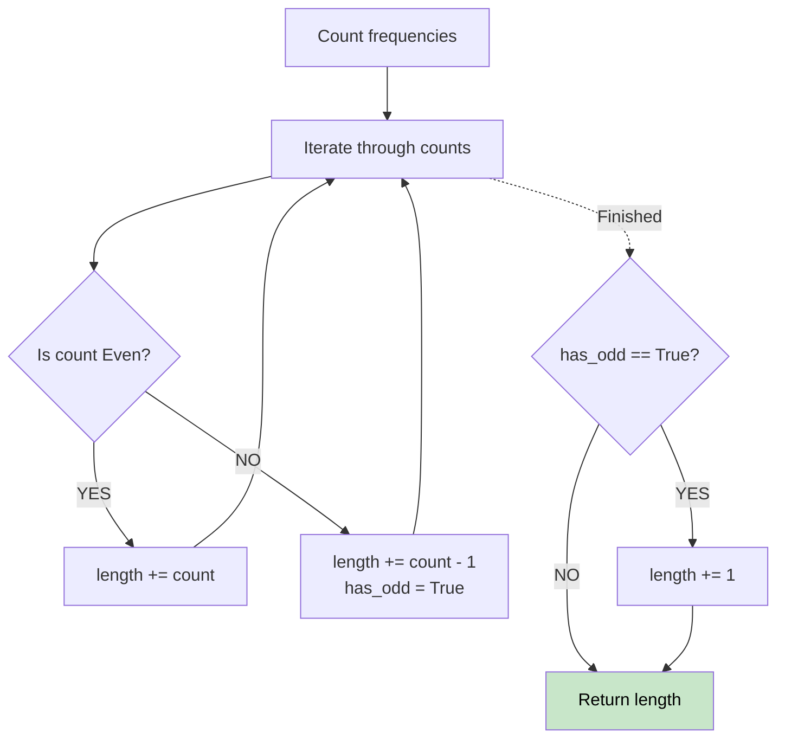

# 🚶‍♂️ Walkthrough: Longest Palindrome

## 👶 Explain Like I'm 5
A palindrome reads the same forwards and backwards (like "racecar"). 
If you have a bunch of scrambled letters, how do you build the longest palindrome possible?
- Any letter you have an EVEN amount of (like 2, 4, 6) can be split in half and put on the left and right sides.
- If you have an ODD amount (like 3), you can still use 2 of them (which is even).
- You can put exactly ONE odd letter smack in the middle (like the 'e' in "racecar").

## 🎯 Core Strategy
**Hash Map Frequency Count**.

1. Count the frequency of every character.
2. Initialize `length = 0` and a flag `has_odd = False`.
3. Loop through the counts:
   - If `count` is EVEN: `length += count`.
   - If `count` is ODD: `length += count - 1` (making it even), and set `has_odd = True`.
4. After checking all letters, if `has_odd` is True, add 1 to `length` (to put one letter in the middle).

## 🏃‍♂️ Step-by-Step Execution (Dry Run)
**Input**: `s = "abccccdd"`

**Counts**: `{'a': 1, 'b': 1, 'c': 4, 'd': 2}`

| char | count | even/odd | length updates | has_odd |
|---|---|---|---|---|
| a | 1 | ODD | +0 | True |
| b | 1 | ODD | +0 | True |
| c | 4 | EVEN | +4 (len=4) | True |
| d | 2 | EVEN | +2 (len=6) | True |

After loop: `has_odd` is True, so `length += 1` -> **7** ✅ (e.g. "dccaccd").

## 📊 Visual Diagram

## 🛑 Complexity
- **Time:** $O(N)$ to count frequencies.
- **Space:** $O(1)$ since the characters are just letters (bounded alphabet size).
