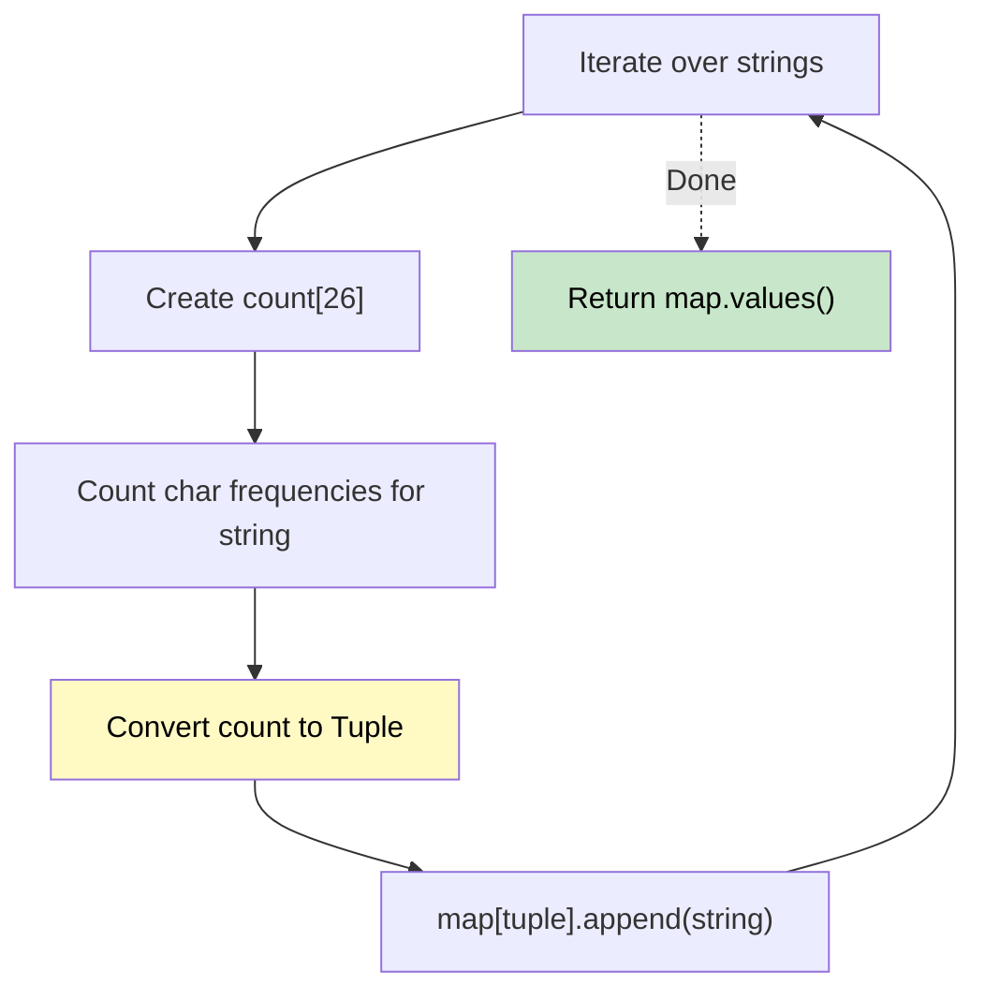

# 🚶‍♂️ Walkthrough: Group Anagrams

## 👶 Explain Like I'm 5
You have a list of words. Group all the anagrams together.
"eat", "tea", and "ate" are all the exact same word if you sort their letters to "aet".
So, "aet" is their ID tag! But sorting strings is a bit slow. Instead, we can just count the letters (1 'a', 1 'e', 1 't') and use that count as the ID tag!

## 🎯 Core Strategy
**Tuple of Frequency Counts as Hash Key**.

1. Create a `groups` Hash Map mapping to lists (`defaultdict(list)`).
2. For each string:
   - Create an array `count` of 26 zeros.
   - Count the frequency of each letter in the string.
   - **Convert the `count` array into a `tuple`**. (Arrays/lists can't be used as dictionary keys in Python, but tuples can because they are immutable).
   - Use the tuple as the key, and append the string to that group.
3. Return all the values in the Hash Map as a list of lists.

## 🏃‍♂️ Step-by-Step Execution (Dry Run)
**Input**: `["eat", "tea", "bat"]`

| string | Count Array (simplified) | Tuple Key | Map State |
|---|---|---|---|
| "eat" | 1 'a', 1 'e', 1 't' | `(1,0,0,0,1,0...,1...)` | `{(1,e,t): ["eat"]}` |
| "tea" | 1 'a', 1 'e', 1 't' | `(1,0,0,0,1,0...,1...)` | `{(1,e,t): ["eat", "tea"]}` |
| "bat" | 1 'a', 1 'b', 1 't' | `(1,1,0,0,0,0...,1...)` | `{(1,e,t): ["eat", "tea"], (1,b,t): ["bat"]}` |

Result: `[["eat", "tea"], ["bat"]]` ✅

## 📊 Visual Diagram

## 🛑 Complexity
- **Time:** $O(N \times K)$ where $N$ is the number of strings and $K$ is the max length of a string.
- **Space:** $O(N \times K)$ to store the grouped strings in the hash map.
