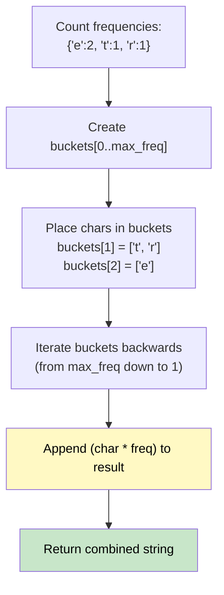

# 🚶‍♂️ Walkthrough: Sort Characters By Frequency

## 👶 Explain Like I'm 5
Sort a word based on how many times a letter appears. Letters that appear the most go first. "tree" -> 'e' appears twice, 't' and 'r' once, so "eert".
We could count them and sort them (which is slow), OR we can use "Buckets". If 'e' appears 2 times, we drop 'e' into Bucket #2. Then we just read the buckets from highest to lowest!

## 🎯 Core Strategy
**Hash Map Frequency Count + Bucket Sort**.

1. Count the frequencies of all characters.
2. Find the `max_freq` (the highest count).
3. Create an array of `buckets` where `buckets[i]` will hold a list of characters that appear exactly `i` times.
4. Iterate through your counts, placing each character into its corresponding bucket.
5. Build the result: loop through the buckets backwards (from `max_freq` down to 1). For every character in that bucket, append it to the result `i` times.

## 🏃‍♂️ Step-by-Step Execution (Dry Run)
**Input**: `s = "tree"`

1. **Counts**: `{'t': 1, 'r': 1, 'e': 2}`. Max frequency = 2.
2. **Buckets**: Create 3 buckets (0, 1, 2).
   - Bucket 0: `[]`
   - Bucket 1: `['t', 'r']`
   - Bucket 2: `['e']`
3. **Build Result** (backwards from 2 down to 1):
   - Check Bucket 2: contains `'e'`. Append `'e' * 2` -> `"ee"`.
   - Check Bucket 1: contains `'t', 'r'`. Append `'t' * 1` -> `"eet"`. Append `'r' * 1` -> `"eetr"`.

Final Output: `"eetr"` ✅

## 📊 Visual Diagram

## 🛑 Complexity
- **Time:** $O(N)$ — Creating the counts, filling buckets, and building the string all take linear time. Avoids the $O(N \log N)$ sorting step!
- **Space:** $O(N)$ for the hash map, buckets, and result string.
