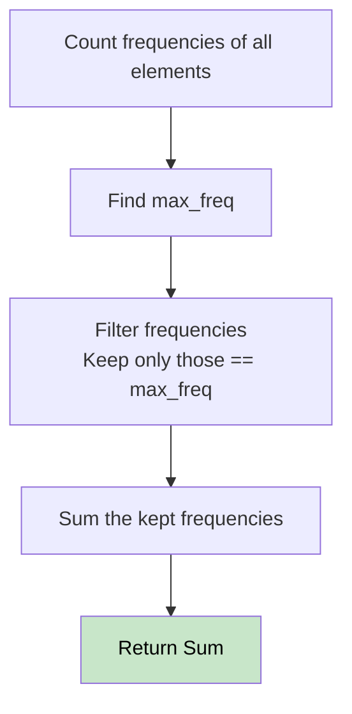

# 🚶‍♂️ Walkthrough: Count Elements With Maximum Frequency

## 👶 Explain Like I'm 5
Find out which number(s) appear the MOST times. Then, tell me the TOTAL count of all those numbers.
If `1` appears twice and `2` appears twice (and that's the most), then $2 + 2 = 4$ total numbers!

## 🎯 Core Strategy
**Frequency Count**.

1. Count the frequency of every element using a Hash Map (`Counter`).
2. Find the highest frequency (`max_freq = max(freq.values())`).
3. Loop through all the frequencies. Every time you see a frequency equal to `max_freq`, add it to a running sum.
4. Return the sum.

## 🏃‍♂️ Step-by-Step Execution (Dry Run)
**Input**: `nums = [1, 2, 2, 3, 1, 4]`

1. **Counts**: `{1: 2, 2: 2, 3: 1, 4: 1}`
2. **Max Freq**: `max([2, 2, 1, 1]) = 2`
3. **Summing**:
   - `freq[1] == 2` (matches max!) -> sum = 2
   - `freq[2] == 2` (matches max!) -> sum = 4
   - `freq[3] == 1` (ignore)
   - `freq[4] == 1` (ignore)

Result = **4** ✅

## 📊 Visual Diagram

## 🛑 Complexity
- **Time:** $O(N)$
- **Space:** $O(N)$ for the frequency counter.
