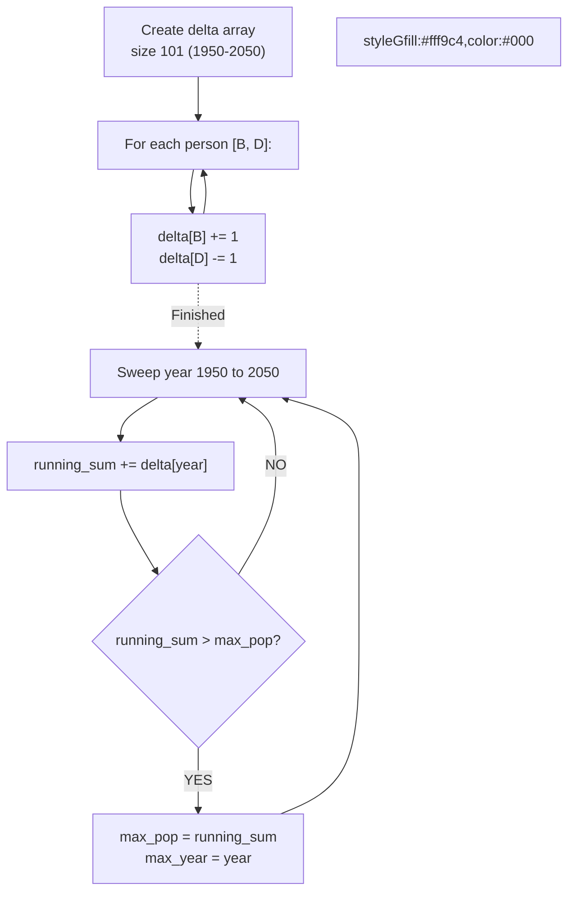

# 🚶‍♂️ Walkthrough: Maximum Population Year

## 👶 Explain Like I'm 5
You have a list of people, with the year they were born and the year they died. 
What year had the most people alive at the same time?
Instead of checking every person for every year, we can just record "changes". In their birth year, the population goes UP by 1. In their death year, the population goes DOWN by 1. Then we just read through the years and keep a running total!

## 🎯 Core Strategy
**Difference Array (Sweep Line)**.

1. Since years are between 1950 and 2050, we only need an array of size 101. (Index 0 = 1950).
2. For each person `[birth, death]`:
   - `delta[birth - 1950] += 1`
   - `delta[death - 1950] -= 1`
3. Sweep through the `delta` array, keeping a `running` sum of the population.
4. Track the `max_pop` and the `max_year` it occurred on. Since we sweep from 1950 upwards, we naturally get the EARLIEST year in case of a tie!

## 🏃‍♂️ Step-by-Step Execution (Dry Run)
**Input**: `logs = [[1950, 1961], [1960, 1971], [1970, 1981]]`

**Delta Array Updates**:
- `[1950, 1961]`: `delta[1950] += 1`, `delta[1961] -= 1`
- `[1960, 1971]`: `delta[1960] += 1`, `delta[1971] -= 1`
- `[1970, 1981]`: `delta[1970] += 1`, `delta[1981] -= 1`

**Sweep Line**:
- Year 1950: `running = 0 + 1 = 1`. `max_pop = 1` (Year 1950)
- ... (stays 1 until 1960)
- Year 1960: `running = 1 + 1 = 2`. `max_pop = 2` (Year 1960)
- Year 1961: `running = 2 - 1 = 1`.
- ...
- Year 1970: `running = 1 + 1 = 2`. `max_pop = 2` (Tie! Keep 1960)
- Year 1971: `running = 2 - 1 = 1`.

Result = **1960** ✅

## 📊 Visual Diagram

## 🛑 Complexity
- **Time:** $O(N + Y)$ where $Y = 101$ (constant). Overall $O(N)$.
- **Space:** $O(Y) = O(1)$ since the range of years is fixed.
