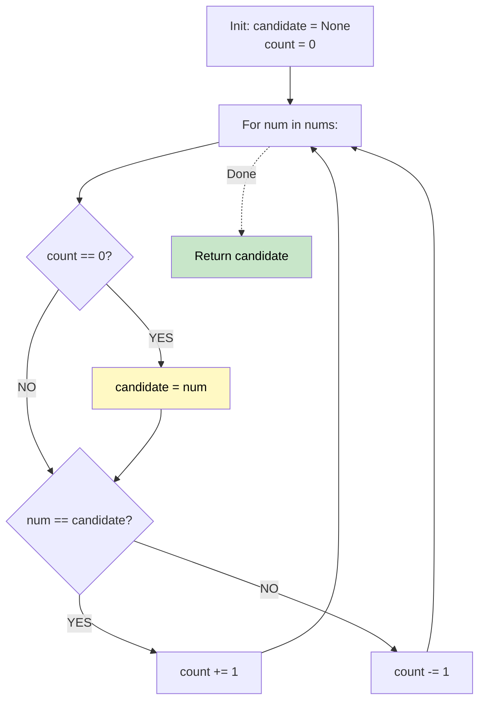

# 🚶‍♂️ Walkthrough: Majority Element

## 👶 Explain Like I'm 5
You have a bunch of votes, and one candidate has strictly MORE THAN HALF the votes.
Imagine a room where people pair up if they voted for different people, and then both leave. Since the winner has more than half the votes, even if everyone else pairs up with the winner's voters and they all leave, there will still be some of the winner's voters left in the room!

## 🎯 Core Strategy
**Boyer-Moore Voting Algorithm**.

1. Maintain a `candidate` and a `count` (starts at 0).
2. Walk through the array:
   - If `count == 0`, whoever you're looking at right now becomes the new `candidate`, and `count = 1`.
   - If you see your `candidate` again, `count += 1`.
   - If you see someone else, `count -= 1` (a "pair" cancels out).
3. At the end, whoever is the `candidate` is the guaranteed winner (because the problem states a majority element *always* exists).

## 🏃‍♂️ Step-by-Step Execution (Dry Run)
**Input**: `nums = [2, 2, 1, 1, 1, 2, 2]`

| num | Action / Reason | candidate | count |
|---|---|---|---|
| 2 | Count is 0 -> New candidate | **2** | 1 |
| 2 | Matches candidate -> count++ | **2** | 2 |
| 1 | Doesn't match -> count-- | **2** | 1 |
| 1 | Doesn't match -> count-- | **2** | 0 |
| 1 | Count is 0 -> New candidate | **1** | 1 |
| 2 | Doesn't match -> count-- | **1** | 0 |
| 2 | Count is 0 -> New candidate | **2** | 1 |

Result = **2** ✅

## 📊 Visual Diagram

## 🛑 Complexity
- **Time:** $O(N)$ — single pass.
- **Space:** $O(1)$ — only keeping track of two variables!
