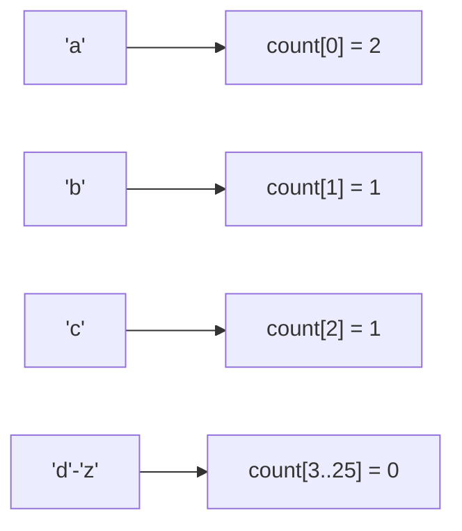
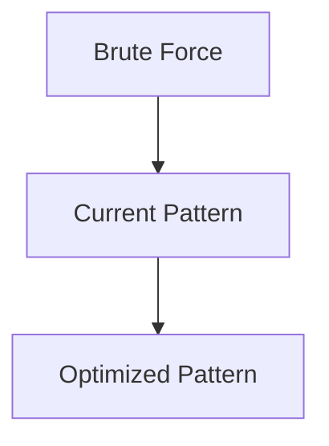

# Pattern 32: Counting Pattern

## 👶 Explain Like I'm 5

Imagine you have a giant bucket of colored balls and someone asks, "Do you have the
same number of red balls and blue balls?"
You *could* line them all up side by side and compare.
Or, you could just grab a clipboard and **COUNT** them as you pull them out:
- Red: 5
- Blue: 5
- Green: 2

By tracking the *frequencies* (how many times something appears), you can instantly
solve problems about matching, finding duplicates, or sorting without actually moving
the items around!

---

## 🧩 Core Idea & Pattern Detection

The **Counting Pattern** (Frequency Counting) is the foundation of Hash Maps and
Counting Sort algorithms. Instead of iterating repeatedly to check conditions,
we build a frequency table (`HashMap` or a simple array of size 26 for alphabets).

### When to use it:
- Finding if two strings are Anagrams.
- Finding the most/least frequent elements.
- Sorting elements when the range of values is very small (Counting Sort).
- Keywords: "anagram", "frequency", "most common", "first unique".

---

## 🔧 Visual Anatomy

Using a Frequency Array for "abac":


Instead of O(N log N) sorting, we can rebuild the sorted string "aabc" in O(N) time!

---

## ⏱️ Complexity Analysis

| Scenario | Time | Space |
|----------|------|-------|
| Array of ASCII characters | O(N) | O(1) (fixed size 128 or 256) |
| Arbitrary Integers | O(N) | O(N) (Hash Map) |

---

## ✅ Problems in This Pattern

| # | Problem | Difficulty | LeetCode |
|---|---------|------------|----------|
| 1 | Valid Anagram | Easy | #242 |
| 2 | First Unique Character | Easy | #387 |
| 3 | Longest Palindrome | Easy | #409 |
| 4 | Group Anagrams | Medium | #49 |
| 5 | Sort Characters By Frequency | Medium | #451 |


## 📦 Prerequisite Data Structures
- Basic understanding of Arrays, Hash Maps, and Counting Pattern fundamentals.


## 🔍 How to Spot This Pattern (Signal Detection)
- **Keywords**: "minimize", "maximize", "combinations", "shortest", "longest".
- **Problem Constraints**: Indicates whether O(N), O(N log N), or O(2^N) is acceptable.


## 🔧 Algorithmic Anatomy
### Variable Table
| Variable | Purpose |
|---|---|
| `result` | Stores the final answer |
| `visited` | Tracks seen elements to avoid cycles or re-processing |

### Step-by-Step Recipe
1. Initialize data structures.
2. Iterate through the input.
3. Update state based on current element.
4. Return result.

### Loop Invariants
- At the start of each iteration, the state reflects the optimal solution up to the previous element.

### DOs and DON'Ts
- **DO**: Trace through an example manually before coding.
- **DON'T**: Forget edge cases like empty inputs.


## 🏗️ Template / Boilerplate Code
```python
def solve_counting_pattern(nums):
    # Initialize state
    result = 0
    for num in nums:
        # Process num
        pass
    return result
```


## 🔄 Brute Force → Optimal Evolution
- **Brute Force**: Try all possibilities (often O(N^2) or O(2^N)).
- **Optimal**: Use this pattern to reduce redundant work to O(N) or O(N log N).


## 🔗 Pattern Connections



## ⚠️ Common Mistakes & Pitfalls
- Off-by-one errors in loop boundaries.
- Not handling negative numbers or zero correctly.
- Forgetting to update the result variable inside the loop.


## 🎤 Interview Communication Guide
1. **Acknowledge**: "This looks like a variation of the classic problem..."
2. **Propose**: "I'll use this pattern because it optimizes the brute force O(N^2) to O(N)."
3. **Execute**: Write clean, modular code.
4. **Review**: Trace with the provided edge case.


## 🧪 Self-Test Questions
<details>
<summary>When should you use this pattern?</summary>
When the problem asks for optimal subarrays, combinations, or specific mathematical properties.
</details>
<details>
<summary>What is the typical time complexity?</summary>
Usually O(N) or O(N log N), depending on sorting or data structure overhead.
</details>
