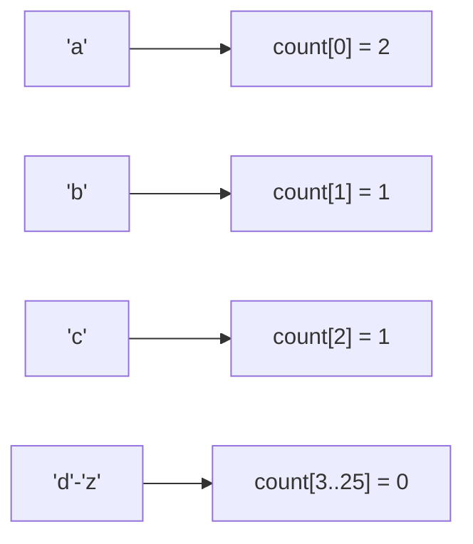

# Pattern 32: Counting Pattern

## 👶 Explain Like I'm 5

Imagine you have a giant bucket of colored balls and someone asks, "Do you have the
same number of red balls and blue balls?"
You *could* line them all up side by side and compare.
Or, you could just grab a clipboard and **COUNT** them as you pull them out:
- Red: 5
- Blue: 5
- Green: 2

By tracking the *frequencies* (how many times something appears), you can instantly
solve problems about matching, finding duplicates, or sorting without actually moving
the items around!

---

## 🧩 Core Idea & Pattern Detection

The **Counting Pattern** (Frequency Counting) is the foundation of Hash Maps and
Counting Sort algorithms. Instead of iterating repeatedly to check conditions,
we build a frequency table (`HashMap` or a simple array of size 26 for alphabets).

### When to use it:
- Finding if two strings are Anagrams.
- Finding the most/least frequent elements.
- Sorting elements when the range of values is very small (Counting Sort).
- Keywords: "anagram", "frequency", "most common", "first unique".

---

## 🔧 Visual Anatomy

Using a Frequency Array for "abac":

Instead of O(N log N) sorting, we can rebuild the sorted string "aabc" in O(N) time!

---

## ⏱️ Complexity Analysis

| Scenario | Time | Space |
|----------|------|-------|
| Array of ASCII characters | O(N) | O(1) (fixed size 128 or 256) |
| Arbitrary Integers | O(N) | O(N) (Hash Map) |

---

## ✅ Problems in This Pattern

| # | Problem | Difficulty | LeetCode |
|---|---------|------------|----------|
| 1 | Valid Anagram | Easy | #242 |
| 2 | First Unique Character | Easy | #387 |
| 3 | Longest Palindrome | Easy | #409 |
| 4 | Group Anagrams | Medium | #49 |
| 5 | Sort Characters By Frequency | Medium | #451 |
