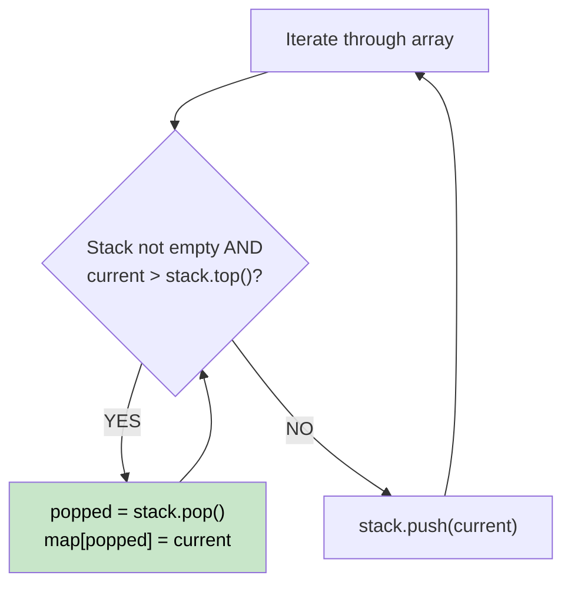

# 🚶‍♂️ Walkthrough: Next Greater Element I

## 👶 Explain Like I'm 5
Imagine you have a line of people with different heights. For each person, you want to know the height of the FIRST person to their right who is taller than them.
Instead of each person looking down the whole line (which takes too long), we have people who haven't found a taller person yet wait in a "waiting room" (a stack). When a really tall person walks by, everyone in the waiting room who is shorter than them immediately says "Aha! You are my next greater person!" and leaves the waiting room.

## 🎯 Core Strategy
**Monotonic Decreasing Stack**.

1. Use a stack to hold numbers that are waiting for their next greater element.
2. The stack will always be strictly decreasing (because if a bigger number came along, it would pop the smaller numbers!).
3. Loop through the array. For the current number:
   - While the stack is not empty AND the current number is greater than the top of the stack:
     - The current number is the "next greater element" for the number at the top of the stack! Pop it and save this relationship in a Hash Map.
   - Push the current number onto the stack so it can wait for its own next greater element.
4. Finally, use the Hash Map to answer the queries for the first array. If a number isn't in the map, it never found a greater element, so output `-1`.

## 🏃‍♂️ Step-by-Step Execution (Dry Run)
**Array**: `[1, 3, 4, 2]`

| num | Stack before | Condition: num > stack top? | Action / Map Updates | New Stack |
|---|---|---|---|---|
| 1 | `[]` | - | Push 1 | `[1]` |
| 3 | `[1]` | 3 > 1? **YES** | Pop 1. `map[1] = 3`. Push 3 | `[3]` |
| 4 | `[3]` | 4 > 3? **YES** | Pop 3. `map[3] = 4`. Push 4 | `[4]` |
| 2 | `[4]` | 2 > 4? NO | Push 2 | `[4, 2]` |

Map: `{1: 3, 3: 4}`. (Numbers 4 and 2 never found a greater element).

## 📊 Visual Diagram

## 🛑 Complexity
- **Time:** $O(N)$ — Every element is pushed onto the stack exactly once and popped at most once.
- **Space:** $O(N)$ — For the stack and the hash map.
