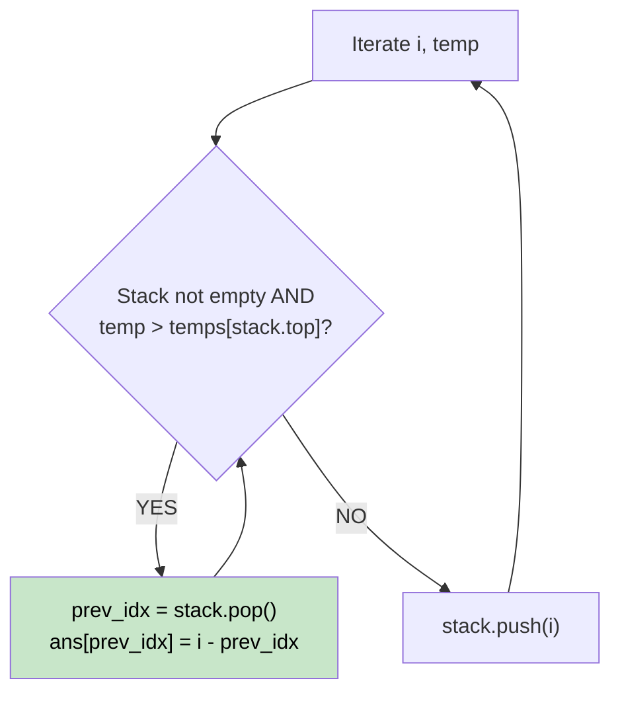

# 🚶‍♂️ Walkthrough: Daily Temperatures

## 👶 Explain Like I'm 5
You have a list of daily temperatures. You want to know how many days you have to wait until it gets warmer.
This is the EXACT SAME problem as "Next Greater Element"! The only difference is that instead of wanting to know the *temperature* of the warmer day, we want to know the *distance* in days. So, instead of putting temperatures in our waiting room (stack), we put the **day index** in there.

## 🎯 Core Strategy
**Monotonic Decreasing Stack (Storing Indices)**.

1. Create a `stack` to store indices. Create an `answer` array filled with 0s.
2. Loop through the temperatures. For the current day `i` with temperature `temp`:
   - While the stack is not empty AND `temp` is greater than the temperature of the day at the top of the stack (`temperatures[stack[-1]]`):
     - Pop the previous day's index from the stack.
     - The answer for that previous day is the difference in days: `i - prev_index`.
   - Push the current day `i` onto the stack.

## 🏃‍♂️ Step-by-Step Execution (Dry Run)
**Input**: `[73, 74, 75, 71, 69, 72]`

| Day (i) | Temp | Stack (Indices) | Action (Temp > Stack Top?) | Answer Array Updates |
|---|---|---|---|---|
| 0 | 73 | `[]` | Push 0 | `[0,0,0,0,0,0]` |
| 1 | 74 | `[0]` | 74 > 73 (YES) -> Pop 0. | `ans[0] = 1 - 0 = 1`. Push 1 |
| 2 | 75 | `[1]` | 75 > 74 (YES) -> Pop 1. | `ans[1] = 2 - 1 = 1`. Push 2 |
| 3 | 71 | `[2]` | 71 > 75 (NO) -> Push 3. | - |
| 4 | 69 | `[2, 3]` | 69 > 71 (NO) -> Push 4. | - |
| 5 | 72 | `[2, 3, 4]` | 72 > 69 (YES) -> Pop 4. | `ans[4] = 5 - 4 = 1`. |
| 5 (cont)| 72 | `[2, 3]` | 72 > 71 (YES) -> Pop 3. | `ans[3] = 5 - 3 = 2`. Push 5 |

Answer Array: `[1, 1, 0, 2, 1, 0]` ✅

## 📊 Visual Diagram

## 🛑 Complexity
- **Time:** $O(N)$
- **Space:** $O(N)$
