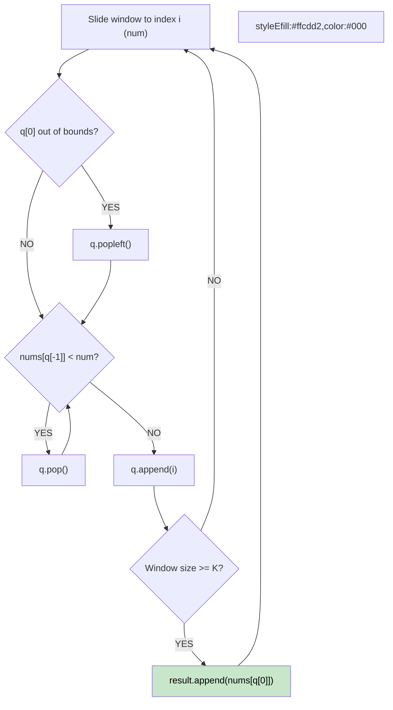

# 🚶‍♂️ Walkthrough: Sliding Window Maximum

## 👶 Explain Like I'm 5
You have a window of size K sliding across an array. You want to know the biggest number in the window at each step.
Imagine a line of people. A new, very tall person walks into the window. Anyone currently in the window who is shorter than the new person is completely useless now—they will *never* be the tallest person because the new tall person is here and will stay in the window longer than them! So, we tell all the shorter people to leave.
The tallest person is always at the front of the line!

## 🎯 Core Strategy
**Monotonic Decreasing Deque**.

Use a double-ended queue (`deque`) to store INDICES. The values at these indices will be strictly decreasing.
1. As the window slides to index `i` (new number `num`):
2. **Remove Out of Bounds:** If the index at the front of the queue is outside our current window (`<= i - K`), `popleft()` it.
3. **Remove Useless:** While the queue is not empty and the number at the back of the queue is `< num`, `pop()` it. (They are smaller and older, so they are useless).
4. **Add New:** Append `i` to the back of the queue.
5. **Record Max:** The maximum for the current window is always at the front of the queue! If our window has reached size K (i.e. `i >= K - 1`), append `nums[deque[0]]` to the result.

## 🏃‍♂️ Step-by-Step Execution (Dry Run)
**Input**: `nums = [1, 3, -1, -3, 5]`, `K = 3`

| i | num | Queue (Indices) | Values in Queue | Out of Bounds Check | Remove Useless Check | Max Added to Result |
|---|---|---|---|---|---|---|
| 0 | 1 | `[0]` | `[1]` | - | - | - (Window not full) |
| 1 | 3 | `[1]` | `[3]` | - | Pop 0 (1 < 3). Add 1. | - (Window not full) |
| 2 | -1 | `[1, 2]` | `[3, -1]` | - | Add 2. | Max is at q[0] = 3. `res=[3]` |
| 3 | -3 | `[1, 2, 3]`| `[3, -1, -3]` | - | Add 3. | Max is at q[0] = 3. `res=[3, 3]` |
| 4 | 5 | `[4]` | `[5]` | Pop 1 (1 <= 4-3). | Pop 3 (-3<5). Pop 2 (-1<5). Add 4. | Max is at q[0] = 5. `res=[3, 3, 5]` |

## 📊 Visual Diagram

## 🛑 Complexity
- **Time:** $O(N)$ — Every index is pushed and popped at most once.
- **Space:** $O(K)$ — The deque stores at most K elements at any time.
