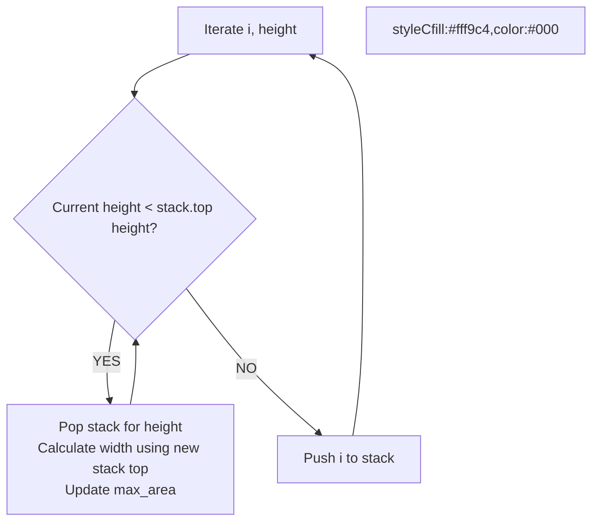

# 🚶‍♂️ Walkthrough: Largest Rectangle in Histogram

## 👶 Explain Like I'm 5
You have a bar chart. What is the largest rectangle you can draw inside it?
A rectangle's height is always limited by the SHORTEST bar it includes.
If we keep a stack of bars that are growing taller, we are good. But the moment we see a SHORT bar, we know that the taller bars before it can't stretch any further to the right! So we can calculate their final rectangle sizes right then and there.

## 🎯 Core Strategy
**Monotonic Increasing Stack**.

1. Use a stack to store INDICES of the bars. The bars in the stack will be strictly increasing in height.
2. We append a `0` height bar at the end of the array. This acts as a trigger to flush out and calculate all remaining bars in the stack at the very end.
3. For each bar at index `i`:
   - While the stack is not empty AND the current bar is SHORTER than the bar at the top of the stack:
     - Pop the top index. This is the `height` of our rectangle.
     - The rectangle extends from the *new* top of the stack (the nearest smaller bar to the left) up to `i` (the nearest smaller bar to the right).
     - `width = i - new_stack_top_index - 1`.
     - `area = height * width`. Update `max_area`.
   - Push `i` onto the stack.

## 🏃‍♂️ Step-by-Step Execution (Dry Run)
**Input**: `[2, 1, 5, 6, 2, 3]` -> Append 0: `[2, 1, 5, 6, 2, 3, 0]`

Stack starts with `-1` (a dummy index to easily calculate width for the very first bar).

| i | height | Stack (Indices) | Action (height < stack_top_height?) | Area Calc |
|---|---|---|---|---|
| 0 | 2 | `[-1, 0]` | - | - |
| 1 | 1 | `[-1, 1]` | 1 < 2 (YES). Pop 0 (height 2). | width = 1 - (-1) - 1 = 1. Area = 2x1 = 2 |
| 2 | 5 | `[-1, 1, 2]` | - | - |
| 3 | 6 | `[-1, 1, 2, 3]` | - | - |
| 4 | 2 | `[-1, 1, 4]` | 2 < 6 (YES). Pop 3 (height 6). | width = 4 - 2 - 1 = 1. Area = 6x1 = 6 |
| 4 | 2 (cont)| `[-1, 1, 4]` | 2 < 5 (YES). Pop 2 (height 5). | width = 4 - 1 - 1 = 2. Area = 5x2 = 10 (MAX) |
| 5 | 3 | `[-1, 1, 4, 5]` | - | - |
| 6 | 0 | `[-1]` | 0 triggers pops for 3, 2, 1 | Max area stays 10. |

## 📊 Visual Diagram

## 🛑 Complexity
- **Time:** $O(N)$
- **Space:** $O(N)$
