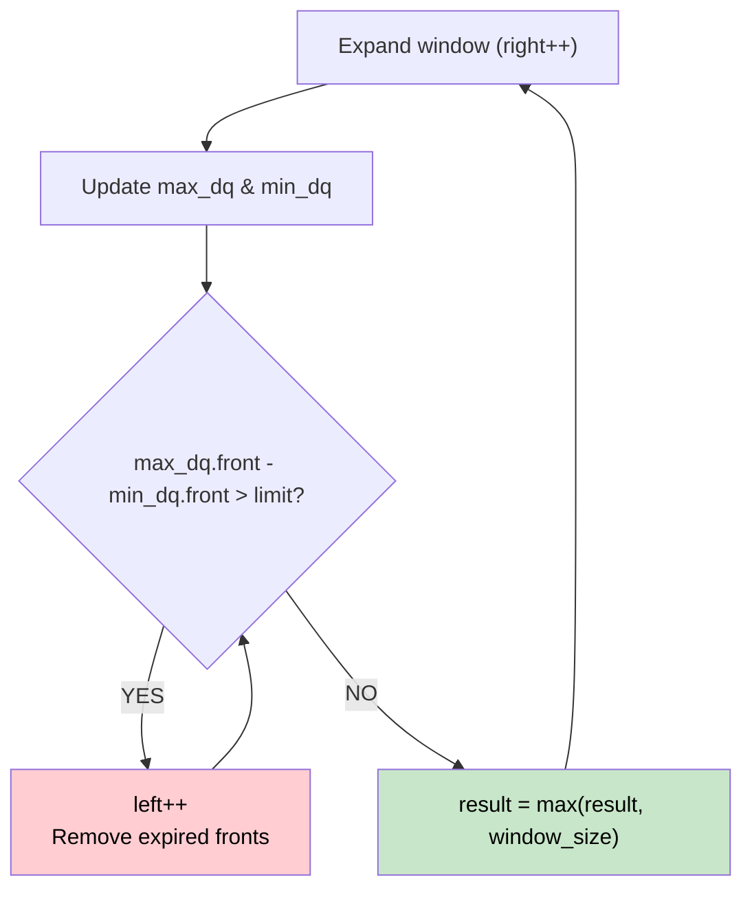

# 🚶‍♂️ Walkthrough: Longest Continuous Subarray With Absolute Diff ≤ Limit

## 👶 Explain Like I'm 5
You want to find the longest subarray where the difference between the maximum and minimum numbers is no more than a given `limit`.
This is exactly like the "Sliding Window Maximum" problem, but now we need to track BOTH the maximum AND the minimum for the sliding window simultaneously!

## 🎯 Core Strategy
**Sliding Window + Two Monotonic Deques**.

1. **Max-Deque**: Stores indices, keeping values in strictly decreasing order. The front of this queue is always the maximum value in our window.
2. **Min-Deque**: Stores indices, keeping values in strictly increasing order. The front of this queue is always the minimum value in our window.
3. Slide the `right` pointer to expand the window, updating both deques.
4. Check the condition: `nums[max_deque[0]] - nums[min_deque[0]] > limit`.
5. If the condition is violated, the window is invalid. We must shrink it by moving the `left` pointer forward. If `left` moves past the index at the front of either deque, we pop that deque from the front.
6. Record the maximum valid window size.

## 🏃‍♂️ Step-by-Step Execution (Dry Run)
**Input**: `nums = [8, 2, 4, 7]`, `limit = 4`

| right | num | max_dq (decreasing) | min_dq (increasing) | max-min | left updates | result |
|---|---|---|---|---|---|---|
| 0 | 8 | `[0]` (val 8) | `[0]` (val 8) | 8-8 = 0 | left=0 | 1 |
| 1 | 2 | `[0,1]` (vals 8,2) | `[1]` (val 2) | 8-2 = 6 > 4! | max-min > limit! -> `left=1`. (0 < 1 so pop max_dq). | 1 |
| 2 | 4 | `[1,2]` (vals 4) | `[1,2]` (vals 2,4) | 4-2 = 2 <= 4 | left=1 | 2 |
| 3 | 7 | `[3]` (val 7) | `[1,2,3]` (vals 2,4,7) | 7-2 = 5 > 4! | max-min > limit! -> `left=2`. (1 < 2 so pop min_dq). | 2 |

*Wait, let's trace right=3 carefully:*
`right=3 (7)`:
- `max_dq` adds 3. `max_dq` = `[3] (7)`
- `min_dq` adds 3. `min_dq` = `[1,2,3] (2,4,7)`
- `max - min = 7 - 2 = 5 > limit`.
- `left` becomes 2. `min_dq` front is 1, which is `< left(2)`. Pop 1 from `min_dq`.
- Now `min_dq` front is 2 (val 4).
- `max - min = 7 - 4 = 3 <= limit`. Valid!
- Window size: `3 - 2 + 1 = 2`. Result = max(2, 2) = 2.

## 📊 Visual Diagram

## 🛑 Complexity
- **Time:** $O(N)$
- **Space:** $O(N)$
