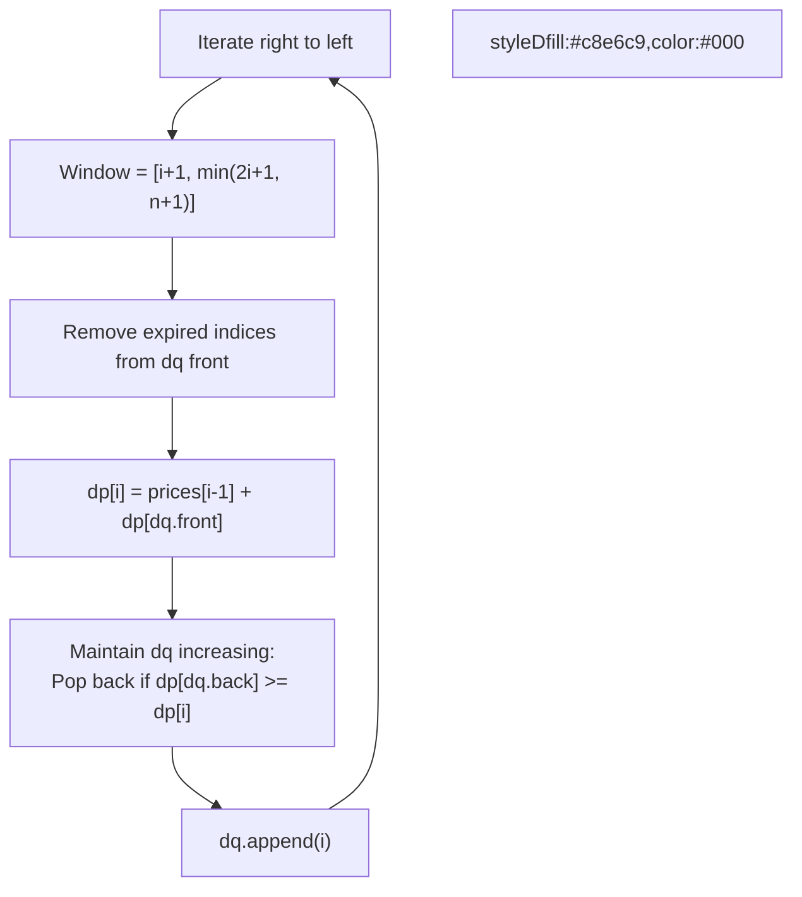

# 🚶‍♂️ Walkthrough: Minimum Number of Coins for Fruits

## 👶 Explain Like I'm 5
You are at a store. If you buy fruit `i`, you get the next `i` fruits completely free! You must get all fruits from 1 to N, and you want to spend the minimum number of coins.
So if you buy fruit 2, you get fruits 3 and 4 for free. This means your next purchase can be anywhere between fruit 3 and fruit 5. We want to find the cheapest choice among those options!

## 🎯 Core Strategy
**Dynamic Programming + Monotonic Queue**.

1. Let `dp[i]` be the minimum cost to acquire all fruits from `i` to the end, ASSUMING you bought fruit `i`.
2. If you buy fruit `i`, it covers you up to `2*i`. Thus, the next fruit you *have* to buy is somewhere in the range `[i+1, 2*i+1]`.
3. So, `dp[i] = prices[i-1] + min(dp[j])` for `j` in the window `[i+1, 2*i+1]`.
4. We can compute `dp` from right to left (N down to 1).
5. To quickly find the `min(dp[j])` in that sliding window, we use a **Monotonic Increasing Deque**, just like in the Sliding Window Maximum problem (but for minimums instead).

## 🏃‍♂️ Step-by-Step Execution (Dry Run)
**Input**: `prices = [3, 1, 2]` (N = 3)
`dp` array of size `N+2` initialized to 0. Deque `dq = [4]`.
We go backwards from 3 to 1.

| i | price | window `[i+1, 2i+1]` | Remove out of window | min dp from dq | dp[i] | Update dq (Increasing) |
|---|---|---|---|---|---|---|
| 3 | 2 | `[4, 7]` -> `[4, 4]` | None | `dq[0]=4`, `dp[4]=0` | 2 + 0 = **2** | `dq = [4, 3]` |
| 2 | 1 | `[3, 5]` -> `[3, 4]` | None | `dq[0]=4`, `dp[4]=0` | 1 + 0 = **1** | pop 3 (`dp[3]=2 >= 1`). `dq = [4, 2]` |
| 1 | 3 | `[2, 3]` | Pop 4 (>3). `dq = [2]` | `dq[0]=2`, `dp[2]=1` | 3 + 1 = **4** | `dq = [2, 1]` |

Result is `dp[1] = 4`. ✅

## 📊 Visual Diagram

## 🛑 Complexity
- **Time:** $O(N)$ — Each index is pushed and popped to the deque at most once.
- **Space:** $O(N)$ — For the `dp` array and the deque.
