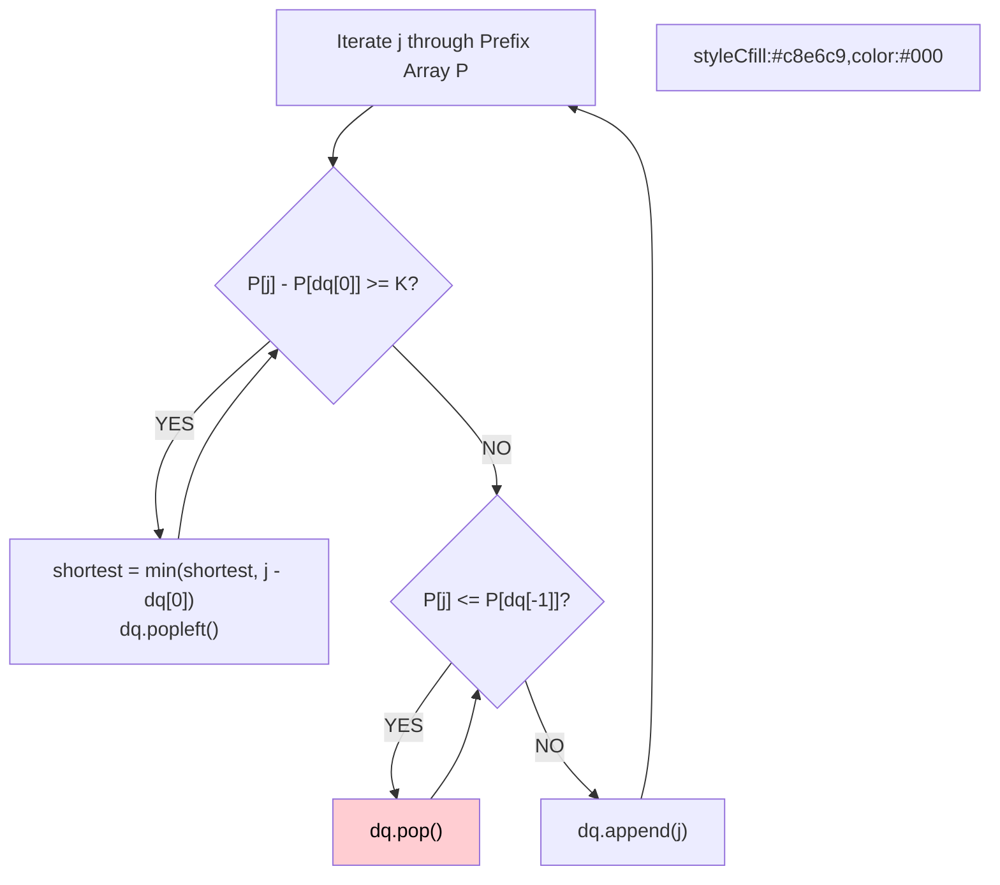

# 🚶‍♂️ Walkthrough: Shortest Subarray with Sum at Least K

## 👶 Explain Like I'm 5
You want to find the shortest contiguous chunk of numbers that adds up to at least `K`.
If all numbers were positive, a simple sliding window would work. But there are NEGATIVE numbers! Adding a number might shrink the sum. We have to use Prefix Sums, and a Monotonic Queue to efficiently track which starting points are worth considering.

## 🎯 Core Strategy
**Prefix Sums + Monotonic Increasing Deque**.

1. Compute a prefix sum array `P`. The sum of a subarray from `i` to `j` is `P[j] - P[i]`. We want `P[j] - P[i] >= K`, which means we are looking for a past `P[i]` such that `P[i] <= P[j] - K`.
2. We iterate through `P` and use a deque to store indices of `P` in **increasing** order of their prefix sum values.
3. Why increasing? If we have a past index `x` and a newer index `y` (where `x < y`), and `P[x] >= P[y]`, then `x` is completely useless! `y` is a better starting point because it comes later (shorter subarray) AND it has a smaller or equal prefix sum (easier to reach K). So we pop `x`!
4. **Finding the answer**: For the current `j`, we check the front of the queue. While `P[j] - P[deque[0]] >= K`, we found a valid subarray! We update our shortest length, and then POP it from the front. Why pop? Because any future `j` that matches with this starting point would result in a LONGER subarray, so we don't need it anymore.

## 🏃‍♂️ Step-by-Step Execution (Dry Run)
**Input**: `nums = [2, -1, 2]`, `K = 3`
`P = [0, 2, 1, 3]`

| j | P[j] | Check Front: `P[j] - P[dq[0]] >= 3` | Maintain Monotonic: `P[j] <= P[dq[-1]]` | Action | Deque | Shortest |
|---|---|---|---|---|---|---|
| 0 | 0 | - | - | Push 0 | `[0]` | inf |
| 1 | 2 | 2 - 0 < 3 (NO) | 2 > 0 (NO) | Push 1 | `[0, 1]` | inf |
| 2 | 1 | 1 - 0 < 3 (NO) | 1 <= 2 (YES) -> Pop 1! | Push 2 | `[0, 2]` | inf |
| 3 | 3 | 3 - 0 = 3 (YES) -> length 3, Pop 0! | 3 > 1 (NO) | Push 3 | `[2, 3]` | 3 |

Shortest = 3 ✅ (The subarray is `[2, -1, 2]`).

## 📊 Visual Diagram

## 🛑 Complexity
- **Time:** $O(N)$
- **Space:** $O(N)$
