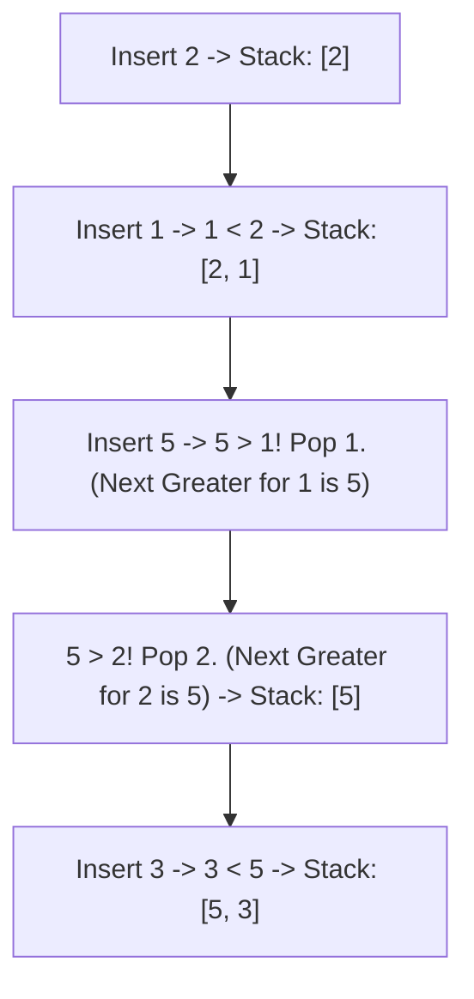
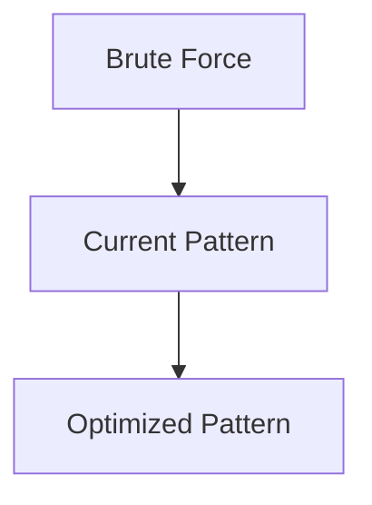

# Pattern 33: Monotonic Queue / Stack Pattern

## 👶 Explain Like I'm 5

Imagine you are standing in a line of people, looking forward.
If a very tall person stands in front of you, you cannot see anyone shorter than them
who is standing further ahead. The shorter people are "useless" to your vision.

A **Monotonic Stack or Queue** does exactly this: it kicks out the "useless" items
whenever a "better" item comes along.
- Monotonic strictly means "always increasing" or "always decreasing".
- By keeping the elements in a strictly increasing or decreasing order, you can answer
  questions like "What is the Next Greater Element?" instantly!

---

## 🧩 Core Idea & Pattern Detection

**Monotonic Stack**: Keep the stack strictly increasing (or decreasing).
When a new element arrives, `while stack and new_element > stack.top()`, we pop from
the stack. The new element is the "Next Greater Element" for everything we just popped!

**Monotonic Queue**: A double-ended queue (deque). Used for Sliding Window problems.
`while deque and new_element > deque.back()`, pop from the back. The front of the deque
always holds the maximum element in the current window.

### When to use it:
- Next Greater / Smaller Element problems.
- Finding the Maximum / Minimum in a Sliding Window in O(N) time.
- Daily Temperatures (how many days until a warmer day).
- Keywords: "next greater", "next smaller", "sliding window maximum".

---

## 🔧 Visual Anatomy

Finding "Next Greater Element" for `[2, 1, 5, 3]`:


Leftovers in stack have NO next greater element!

---

## ⏱️ Complexity Analysis

| Scenario | Time | Space |
|----------|------|-------|
| Monotonic Stack / Queue | O(N) | O(N) |

Even though there's a `while` loop inside a `for` loop, every element is pushed exactly
once and popped at most once. 2N operations = O(N).

---

## ✅ Problems in This Pattern

| # | Problem | Difficulty | LeetCode |
|---|---------|------------|----------|
| 1 | Next Greater Element I | Easy | #496 |
| 2 | Daily Temperatures | Medium | #739 |
| 3 | Sliding Window Maximum | Hard | #239 |
| 4 | Largest Rectangle in Histogram | Hard | #84 |


## 📦 Prerequisite Data Structures
- Basic understanding of Arrays, Hash Maps, and Monotonic Queue Pattern fundamentals.


## 🔍 How to Spot This Pattern (Signal Detection)
- **Keywords**: "minimize", "maximize", "combinations", "shortest", "longest".
- **Problem Constraints**: Indicates whether O(N), O(N log N), or O(2^N) is acceptable.


## 🔧 Algorithmic Anatomy
### Variable Table
| Variable | Purpose |
|---|---|
| `result` | Stores the final answer |
| `visited` | Tracks seen elements to avoid cycles or re-processing |

### Step-by-Step Recipe
1. Initialize data structures.
2. Iterate through the input.
3. Update state based on current element.
4. Return result.

### Loop Invariants
- At the start of each iteration, the state reflects the optimal solution up to the previous element.

### DOs and DON'Ts
- **DO**: Trace through an example manually before coding.
- **DON'T**: Forget edge cases like empty inputs.


## 🏗️ Template / Boilerplate Code
```python
def solve_monotonic_queue_pattern(nums):
    # Initialize state
    result = 0
    for num in nums:
        # Process num
        pass
    return result
```


## 🔄 Brute Force → Optimal Evolution
- **Brute Force**: Try all possibilities (often O(N^2) or O(2^N)).
- **Optimal**: Use this pattern to reduce redundant work to O(N) or O(N log N).


## 🔗 Pattern Connections



## ⚠️ Common Mistakes & Pitfalls
- Off-by-one errors in loop boundaries.
- Not handling negative numbers or zero correctly.
- Forgetting to update the result variable inside the loop.


## 🎤 Interview Communication Guide
1. **Acknowledge**: "This looks like a variation of the classic problem..."
2. **Propose**: "I'll use this pattern because it optimizes the brute force O(N^2) to O(N)."
3. **Execute**: Write clean, modular code.
4. **Review**: Trace with the provided edge case.


## 🧪 Self-Test Questions
<details>
<summary>When should you use this pattern?</summary>
When the problem asks for optimal subarrays, combinations, or specific mathematical properties.
</details>
<details>
<summary>What is the typical time complexity?</summary>
Usually O(N) or O(N log N), depending on sorting or data structure overhead.
</details>
