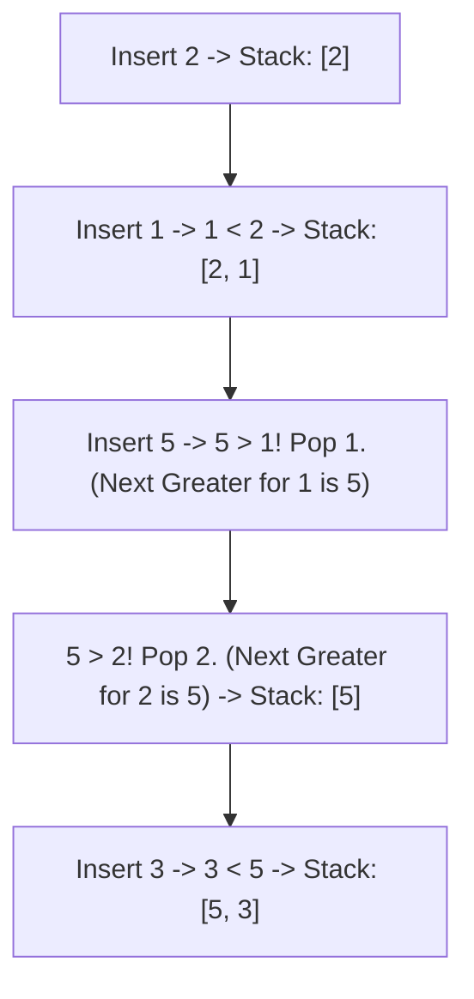

# Pattern 33: Monotonic Queue / Stack Pattern

## 👶 Explain Like I'm 5

Imagine you are standing in a line of people, looking forward.
If a very tall person stands in front of you, you cannot see anyone shorter than them
who is standing further ahead. The shorter people are "useless" to your vision.

A **Monotonic Stack or Queue** does exactly this: it kicks out the "useless" items
whenever a "better" item comes along.
- Monotonic strictly means "always increasing" or "always decreasing".
- By keeping the elements in a strictly increasing or decreasing order, you can answer
  questions like "What is the Next Greater Element?" instantly!

---

## 🧩 Core Idea & Pattern Detection

**Monotonic Stack**: Keep the stack strictly increasing (or decreasing).
When a new element arrives, `while stack and new_element > stack.top()`, we pop from
the stack. The new element is the "Next Greater Element" for everything we just popped!

**Monotonic Queue**: A double-ended queue (deque). Used for Sliding Window problems.
`while deque and new_element > deque.back()`, pop from the back. The front of the deque
always holds the maximum element in the current window.

### When to use it:
- Next Greater / Smaller Element problems.
- Finding the Maximum / Minimum in a Sliding Window in O(N) time.
- Daily Temperatures (how many days until a warmer day).
- Keywords: "next greater", "next smaller", "sliding window maximum".

---

## 🔧 Visual Anatomy

Finding "Next Greater Element" for `[2, 1, 5, 3]`:

Leftovers in stack have NO next greater element!

---

## ⏱️ Complexity Analysis

| Scenario | Time | Space |
|----------|------|-------|
| Monotonic Stack / Queue | O(N) | O(N) |

Even though there's a `while` loop inside a `for` loop, every element is pushed exactly
once and popped at most once. 2N operations = O(N).

---

## ✅ Problems in This Pattern

| # | Problem | Difficulty | LeetCode |
|---|---------|------------|----------|
| 1 | Next Greater Element I | Easy | #496 |
| 2 | Daily Temperatures | Medium | #739 |
| 3 | Sliding Window Maximum | Hard | #239 |
| 4 | Largest Rectangle in Histogram | Hard | #84 |
