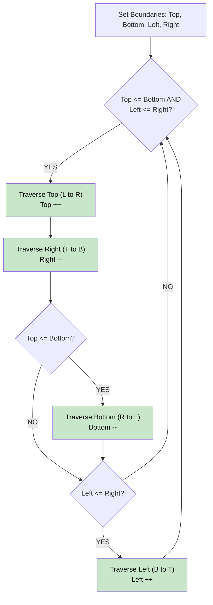

# 🚶‍♂️ Walkthrough: Spiral Matrix

## 👶 Explain Like I'm 5
Imagine drawing a spiral on a grid of numbers. You start at the top left, draw a line all the way to the right edge, then down to the bottom edge, then left, then up. You just drew a box! Now, you step inside the box and draw a smaller box. Keep doing this until there are no numbers left.
We can do exactly this by keeping track of 4 invisible walls: `top`, `bottom`, `left`, and `right`. Every time we finish walking along a wall, we move that wall inward!

## 🎯 Core Strategy
**Boundary Shrinking Simulation**.

1. Define 4 variables: `top = 0`, `bottom = rows - 1`, `left = 0`, `right = cols - 1`.
2. Loop while `top <= bottom` and `left <= right`:
   - Walk along the `top` wall from `left` to `right`. Add numbers to result. Move `top` down (`top += 1`).
   - Walk along the `right` wall from `top` to `bottom`. Add numbers. Move `right` left (`right -= 1`).
   - (Check if `top <= bottom` before proceeding to avoid double-counting if the matrix is a thin line).
   - Walk along the `bottom` wall from `right` to `left`. Add numbers. Move `bottom` up (`bottom -= 1`).
   - (Check if `left <= right`).
   - Walk along the `left` wall from `bottom` to `top`. Add numbers. Move `left` right (`left += 1`).

## 🏃‍♂️ Step-by-Step Execution (Dry Run)
**Matrix**:
```
[1, 2, 3]
[4, 5, 6]
[7, 8, 9]
```
`top=0, bottom=2, left=0, right=2`

1. **Top Row**: (r=0, c=0..2) -> `[1, 2, 3]`. `top` becomes 1.
2. **Right Col**: (r=1..2, c=2) -> `[6, 9]`. `right` becomes 1.
3. **Bottom Row**: (r=2, c=1..0) -> `[8, 7]`. `bottom` becomes 1.
4. **Left Col**: (r=1, c=0) -> `[4]`. `left` becomes 1.
(Now `top=1, bottom=1, left=1, right=1`)
5. **Top Row**: (r=1, c=1) -> `[5]`. `top` becomes 2.
(Loop ends because `top > bottom`).

Result: `[1, 2, 3, 6, 9, 8, 7, 4, 5]` ✅

## 📊 Visual Diagram



## 🛑 Complexity
- **Time:** $O(R \times C)$ — Every cell is visited exactly once.
- **Space:** $O(1)$ — Only tracking 4 variables (excluding the output array).
