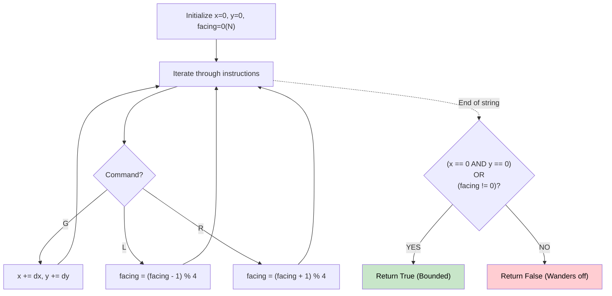

# 🚶‍♂️ Walkthrough: Robot Bounded In Circle

## 👶 Explain Like I'm 5
You program a robot with a sequence of instructions. It executes them, then repeats them forever. Will it wander off to infinity, or stay trapped in a small area?
If the robot does ONE full set of instructions and ends up facing North (the same way it started) BUT it has moved away from its starting spot, it will keep walking North forever!
But if it faces any OTHER direction at the end of the sequence, it will eventually loop back to the start! (For example, if it ends facing East, doing it 4 times forms a square back to the start).
And if it ends up exactly back at the start, obviously it's bounded!

## 🎯 Core Strategy
**Simulate One Cycle + State Check**.

1. Represent directions as an array: `[(0, 1), (1, 0), (0, -1), (-1, 0)]` (North, East, South, West).
2. Track `x = 0`, `y = 0` and `facing = 0` (North).
3. Loop through the instructions:
   - `'G'`: Add current direction vector to `(x, y)`.
   - `'L'`: Turn left: `facing = (facing - 1) % 4`.
   - `'R'`: Turn right: `facing = (facing + 1) % 4`.
4. At the end of the instructions, check if it's trapped:
   - Are we back at the origin? `(x == 0 and y == 0)`
   - OR are we facing a direction other than North? `facing != 0`
   - If either is true, the robot is bounded!

## 🏃‍♂️ Step-by-Step Execution (Dry Run)
**Input**: `"GL"`

| Instruction | Action | (x, y) | Facing |
|---|---|---|---|
| (Start) | - | (0, 0) | 0 (North) |
| G | Move North | (0, 1) | 0 (North) |
| L | Turn Left | (0, 1) | 3 (West) |

**Check at end**:
- `x=0, y=1` (Not at origin).
- `facing = 3` (Not North!).
Because it's facing West, doing it again goes West then turns South, etc. It forms a square!
Returns **True** (Bounded) ✅

## 📊 Visual Diagram

## 🛑 Complexity
- **Time:** $O(N)$ where N is the length of instructions.
- **Space:** $O(1)$
