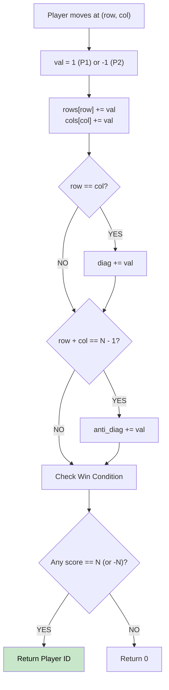

# 🚶‍♂️ Walkthrough: Design Tic-Tac-Toe

## 👶 Explain Like I'm 5
You are building a game of Tic-Tac-Toe. But checking the board every time someone makes a move takes too long.
Instead of a grid, imagine you have a tug-of-war rope for every row and column. Player 1 pulls to the right (+1), Player 2 pulls to the left (-1). If any rope gets pulled all the way to +3, Player 1 wins! If it goes to -3, Player 2 wins!

## 🎯 Core Strategy
**Row/Col Score Accumulation**.

Instead of storing the 2D grid, we store:
- An array `rows` of size N (scores for each row)
- An array `cols` of size N (scores for each col)
- An integer `diag` (score for the top-left to bottom-right diagonal)
- An integer `anti_diag` (score for the top-right to bottom-left diagonal)

When Player 1 makes a move at `(r, c)`, we add +1 to `rows[r]`, `cols[c]`, and the diagonals if applicable.
If any of these values reaches exactly `N`, Player 1 wins! Player 2 does the same with `-1`, trying to reach `-N`.

## 🏃‍♂️ Step-by-Step Execution (Dry Run)
**N = 3**.
Player 1 moves at `(0, 0)`:
- `rows[0] += 1` -> 1
- `cols[0] += 1` -> 1
- (It's on diag): `diag += 1` -> 1
Does anything equal 3? No. Return 0.

Player 1 moves at `(1, 1)`:
- `rows[1] += 1` -> 1
- `cols[1] += 1` -> 1
- `diag += 1` -> 2
- `anti_diag += 1` -> 1

Player 1 moves at `(2, 2)`:
- `rows[2] += 1` -> 1
- `cols[2] += 1` -> 1
- `diag += 1` -> **3!**
`diag` equals 3 (which is N). Return 1 (Player 1 wins!).

## 📊 Visual Diagram

## 🛑 Complexity
- **Time:** $O(1)$ per move!
- **Space:** $O(N)$ for the row and col arrays.
