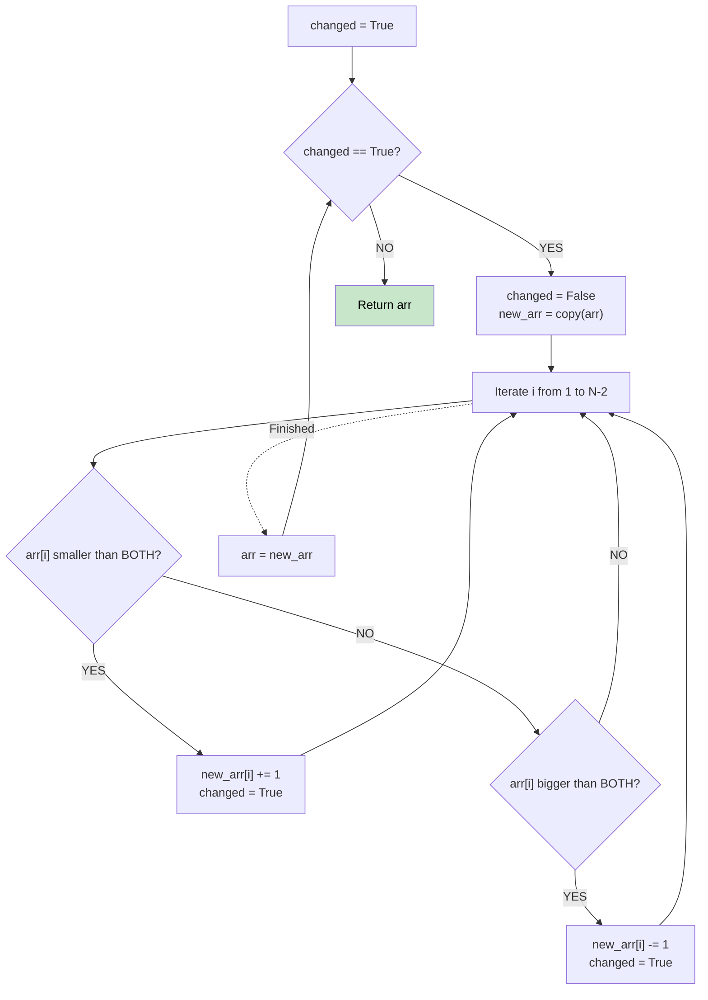

# 🚶‍♂️ Walkthrough: Array Transformation

## 👶 Explain Like I'm 5
You have a line of numbers. Every day, each number looks at the person to its left and its right. 
- If it is SMALLER than both, it grows by 1.
- If it is BIGGER than both, it shrinks by 1.
Everyone changes at the exact same time every day. This keeps happening until nobody needs to change anymore. We just simulate this day by day!

## 🎯 Core Strategy
**Iterative Simulation**.

1. Use a `while` loop that continues as long as `changed` is True.
2. Inside the loop, set `changed = False`.
3. Create a **copy** of the array (`new_arr`). We need a copy because all changes must happen simultaneously based on the *previous* day's numbers.
4. Loop through the array from index 1 to `len-2` (ignoring the first and last elements since they don't have two neighbors).
   - If `arr[i] < arr[i-1]` AND `arr[i] < arr[i+1]`, then `new_arr[i] += 1` and set `changed = True`.
   - If `arr[i] > arr[i-1]` AND `arr[i] > arr[i+1]`, then `new_arr[i] -= 1` and set `changed = True`.
5. Update `arr` to be `new_arr` for the next day.
6. When the loop finishes (because nothing changed), return the array.

## 🏃‍♂️ Step-by-Step Execution (Dry Run)
**Input**: `arr = [6, 2, 3, 4]`

**Day 1**:
- Create `new_arr = [6, 2, 3, 4]`
- `i = 1` (val 2): Neighbors are 6 and 3. `2 < 6` and `2 < 3`. It grows! `new_arr[1] = 3`. `changed = True`.
- `i = 2` (val 3): Neighbors are 2 and 4. `3 > 2` but `3 < 4`. No change.
- End of Day 1: `arr = [6, 3, 3, 4]`

**Day 2**:
- Create `new_arr = [6, 3, 3, 4]`
- `i = 1` (val 3): Neighbors 6, 3. No change.
- `i = 2` (val 3): Neighbors 3, 4. No change.
- `changed` remains False!

Result = `[6, 3, 3, 4]` ✅

## 📊 Visual Diagram

## 🛑 Complexity
- **Time:** $O(N \times \text{max\_val})$ — In the worst case, a peak/valley shrinks/grows by 1 each day.
- **Space:** $O(N)$ for the `new_arr` copy.
