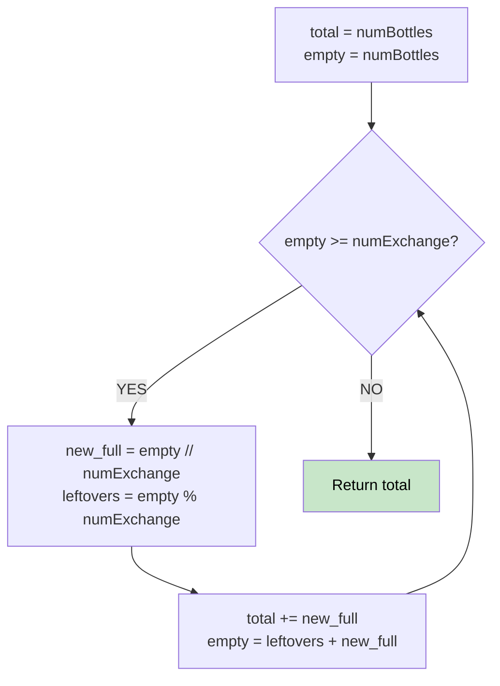

# 🚶‍♂️ Walkthrough: Water Bottles

## 👶 Explain Like I'm 5
You buy 9 full water bottles. You drink them all, giving you 9 empty bottles.
The store says "Give me 3 empty bottles, and I'll give you 1 full bottle."
So you trade 9 empty bottles for 3 full ones! You drink those, get 3 more empty ones, and trade them for 1 more full one!
We just simulate drinking and trading until we don't have enough empties to trade anymore.

## 🎯 Core Strategy
**Iterative Simulation**.

1. Track `total_drunk = numBottles` and `empty = numBottles`.
2. Loop as long as `empty >= numExchange`:
   - Calculate how many new full bottles you get: `new_full = empty // numExchange`.
   - Calculate how many empty bottles are left over (that couldn't be exchanged): `empty % numExchange`.
   - Drink the new full bottles! Add them to `total_drunk`.
   - Update your `empty` count: it's the leftovers PLUS the `new_full` bottles you just drank!
3. Return `total_drunk`.

## 🏃‍♂️ Step-by-Step Execution (Dry Run)
**Input**: `numBottles = 9`, `numExchange = 3`

**Start**: `total_drunk = 9`, `empty = 9`

**Loop 1**: `empty >= 3`? YES (9 >= 3).
- `new_full = 9 // 3 = 3`
- Leftover empties = `9 % 3 = 0`
- `total_drunk = 9 + 3 = 12`
- `empty = 0 (leftover) + 3 (newly drunk) = 3`

**Loop 2**: `empty >= 3`? YES (3 >= 3).
- `new_full = 3 // 3 = 1`
- Leftover empties = `3 % 3 = 0`
- `total_drunk = 12 + 1 = 13`
- `empty = 0 + 1 = 1`

**Loop 3**: `empty >= 3`? NO (1 < 3).

Result = 13 ✅

## 📊 Visual Diagram

## 🛑 Complexity
- **Time:** $O(\log N)$ — The number of empty bottles divides by `numExchange` each step, so it shrinks logarithmically.
- **Space:** $O(1)$
