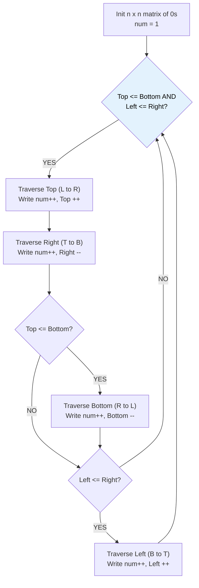

# 🚶‍♂️ Walkthrough: Spiral Matrix II

## 👶 Explain Like I'm 5
Instead of *reading* a grid in a spiral, we are *writing* a grid in a spiral!
We start with a blank grid. We have a counter starting at 1. We walk right along the top wall writing numbers, then down the right wall, left along the bottom, and up the left wall. Every time we finish a wall, we move it inward. We stop when we reach `n * n`.

## 🎯 Core Strategy
**Boundary Shrinking Simulation (Writing)**.

This is exactly the same algorithm as Spiral Matrix I, but we write to `matrix[r][c] = num` instead of reading from it.
1. Create an $n \times n$ matrix filled with 0s.
2. Initialize `top = 0, bottom = n-1, left = 0, right = n-1`.
3. Initialize `num = 1`.
4. While `top <= bottom` and `left <= right`:
   - Traverse Top (L to R): write `num`, `num++`. `top++`.
   - Traverse Right (T to B): write `num`, `num++`. `right--`.
   - Traverse Bottom (R to L): write `num`, `num++`. `bottom--`.
   - Traverse Left (B to T): write `num`, `num++`. `left++`.
5. Return the matrix.

## 🏃‍♂️ Step-by-Step Execution (Dry Run)
**Input**: `n = 3`. `num` goes up to 9.
`top=0, bottom=2, left=0, right=2`

1. **Top Row** (0,0 to 0,2): Writes `1, 2, 3`. `top = 1`.
2. **Right Col** (1,2 to 2,2): Writes `4, 5`. `right = 1`.
3. **Bottom Row** (2,1 to 2,0): Writes `6, 7`. `bottom = 1`.
4. **Left Col** (1,0): Writes `8`. `left = 1`.
(Now `top=1, bottom=1, left=1, right=1`)
5. **Top Row** (1,1): Writes `9`. `top = 2`.
Loop ends!

Grid looks like:
```
[1, 2, 3]
[8, 9, 4]
[7, 6, 5]
```
✅

## 📊 Visual Diagram



## 🛑 Complexity
- **Time:** $O(N^2)$ — Every cell is written to exactly once.
- **Space:** $O(1)$ — Excluding the required output matrix.
