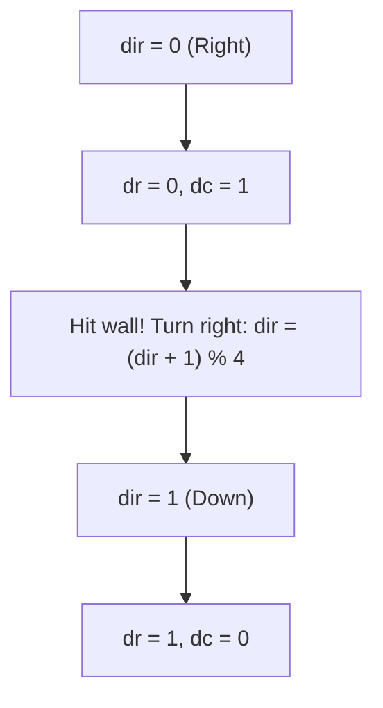
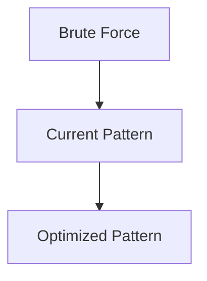

# Pattern 34: Simulation Pattern

## 👶 Explain Like I'm 5

Imagine playing a board game where the card says:
"Move forward 3 spaces, turn right, and if you land on a red square, go back 1 space."
You don't need a fancy math formula to figure out where you end up. You just
**do exactly what the card says**, step by step, and see where you finish!

In programming, a **Simulation** problem is one where the easiest (or only) way
to solve it is to simply "play the game" according to the rules given in the problem.

---

## 🧩 Core Idea & Pattern Detection

There is no "secret data structure" for Simulation. The challenge is usually about
translating complex, wordy rules into clean, bug-free code.

### Strategies for Simulation:
1. **Direction Vectors**: If moving on a grid, use arrays like `dr = [0, 1, 0, -1]` and `dc = [1, 0, -1, 0]` to represent Right, Down, Left, Up.
2. **State Machines**: Keep track of the current "state" (e.g., heading North, heading East).
3. **Boundary Checks**: Always know your limits (`0 <= r < ROWS`).
4. **Copying States**: If elements update simultaneously (like Game of Life), you must read from the *old* state while writing to a *new* state (or use bit manipulation trickery).

### When to use it:
- Traversing a matrix in a spiral.
- Simulating a robot's movements.
- Grid games (Tic-Tac-Toe, Minesweeper, Game of Life).
- Keywords: "simulate", "robot moves", "turn right", "spiral".

---

## 🔧 Visual Anatomy

Using Direction Vectors for Grid Movement (Right -> Down -> Left -> Up):



---

## ⏱️ Complexity Analysis

| Scenario | Time | Space |
|----------|------|-------|
| Matrix Traversal | O(R * C) | O(1) (excluding output) |
| Robot Instructions | O(N) | O(1) |

---

## ✅ Problems in This Pattern

| # | Problem | Difficulty | LeetCode |
|---|---------|------------|----------|
| 1 | Spiral Matrix | Medium | #54 |
| 2 | Robot Bounded In Circle | Medium | #1041 |
| 3 | Game of Life | Medium | #289 |
| 4 | Design Tic-Tac-Toe | Medium | #348 |


## 📦 Prerequisite Data Structures
- Basic understanding of Arrays, Hash Maps, and Simulation Pattern fundamentals.


## 🔍 How to Spot This Pattern (Signal Detection)
- **Keywords**: "minimize", "maximize", "combinations", "shortest", "longest".
- **Problem Constraints**: Indicates whether O(N), O(N log N), or O(2^N) is acceptable.


## 🔧 Algorithmic Anatomy
### Variable Table
| Variable | Purpose |
|---|---|
| `result` | Stores the final answer |
| `visited` | Tracks seen elements to avoid cycles or re-processing |

### Step-by-Step Recipe
1. Initialize data structures.
2. Iterate through the input.
3. Update state based on current element.
4. Return result.

### Loop Invariants
- At the start of each iteration, the state reflects the optimal solution up to the previous element.

### DOs and DON'Ts
- **DO**: Trace through an example manually before coding.
- **DON'T**: Forget edge cases like empty inputs.


## 🏗️ Template / Boilerplate Code
```python
def solve_simulation_pattern(nums):
    # Initialize state
    result = 0
    for num in nums:
        # Process num
        pass
    return result
```


## 🔄 Brute Force → Optimal Evolution
- **Brute Force**: Try all possibilities (often O(N^2) or O(2^N)).
- **Optimal**: Use this pattern to reduce redundant work to O(N) or O(N log N).


## 🔗 Pattern Connections



## ⚠️ Common Mistakes & Pitfalls
- Off-by-one errors in loop boundaries.
- Not handling negative numbers or zero correctly.
- Forgetting to update the result variable inside the loop.


## 🎤 Interview Communication Guide
1. **Acknowledge**: "This looks like a variation of the classic problem..."
2. **Propose**: "I'll use this pattern because it optimizes the brute force O(N^2) to O(N)."
3. **Execute**: Write clean, modular code.
4. **Review**: Trace with the provided edge case.


## 🧪 Self-Test Questions
<details>
<summary>When should you use this pattern?</summary>
When the problem asks for optimal subarrays, combinations, or specific mathematical properties.
</details>
<details>
<summary>What is the typical time complexity?</summary>
Usually O(N) or O(N log N), depending on sorting or data structure overhead.
</details>
