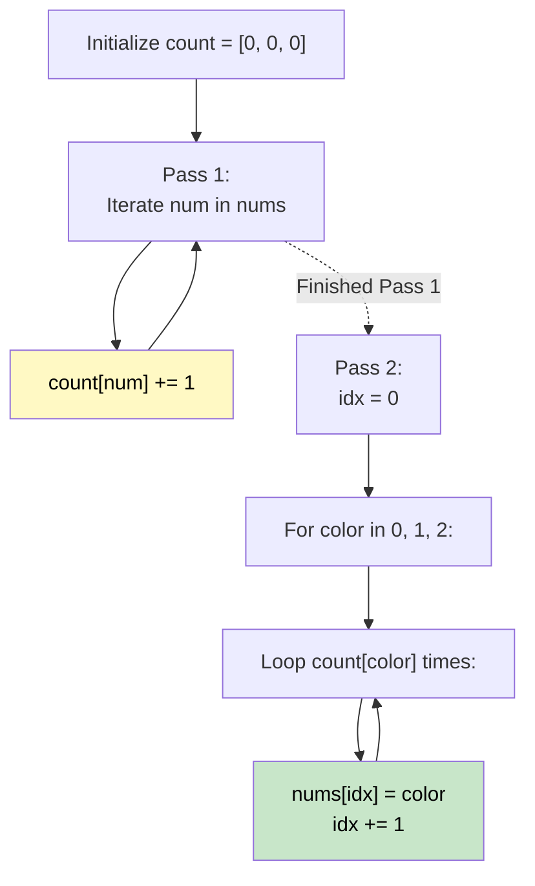

# 🚶‍♂️ Walkthrough: Sort Colors

## 👶 Explain Like I'm 5
You have a bunch of red (0), white (1), and blue (2) balls mixed up in a line. You need to group all the reds together first, then whites, then blues.
Instead of doing a complicated sorting routine, just walk down the line once and count how many reds, whites, and blues there are! Once you know you have exactly 3 reds, 2 whites, and 1 blue, just walk down the line a second time and paint the first 3 balls red, the next 2 white, and the last 1 blue.

## 🎯 Core Strategy
**Counting Sort (Two-Pass)**.

*Note: The famous "Dutch National Flag" algorithm solves this in one pass using pointers, but since this section focuses on Linear Sorting, Counting Sort is the quintessential example.*

1. **Pass 1 (Counting)**: Create an array `count = [0, 0, 0]`. Iterate through the input array `nums`. If you see a 0, `count[0] += 1`. If 1, `count[1] += 1`, etc.
2. **Pass 2 (Overwriting)**: Keep a pointer `idx = 0` to track your position in the original array.
   - Loop `count[0]` times: set `nums[idx] = 0`, then `idx += 1`.
   - Loop `count[1]` times: set `nums[idx] = 1`, then `idx += 1`.
   - Loop `count[2]` times: set `nums[idx] = 2`, then `idx += 1`.

## 🏃‍♂️ Step-by-Step Execution (Dry Run)
**Input**: `nums = [2, 0, 2, 1, 1, 0]`

**Pass 1 (Counting)**:
- 2 -> `count = [0, 0, 1]`
- 0 -> `count = [1, 0, 1]`
- 2 -> `count = [1, 0, 2]`
- 1 -> `count = [1, 1, 2]`
- 1 -> `count = [1, 2, 2]`
- 0 -> `count = [2, 2, 2]`

**Pass 2 (Overwriting)**:
- We have two 0s. Set `nums[0] = 0`, `nums[1] = 0`. (`idx` is now 2)
- We have two 1s. Set `nums[2] = 1`, `nums[3] = 1`. (`idx` is now 4)
- We have two 2s. Set `nums[4] = 2`, `nums[5] = 2`.

Result = `[0, 0, 1, 1, 2, 2]` ✅

## 📊 Visual Diagram

## 🛑 Complexity
- **Time:** $O(N)$ — Exactly two passes over the array.
- **Space:** $O(1)$ — The `count` array is always size 3, which is constant space.
