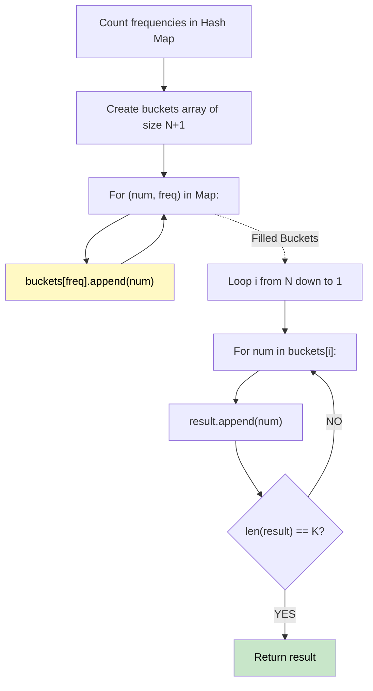

# 🚶‍♂️ Walkthrough: Top K Frequent Elements

## 👶 Explain Like I'm 5
You have a bunch of numbers and you want to find the top `K` most popular ones.
We can count them first. Let's say you have 3 apples, 2 bananas, and 1 orange. 
We can set up a bunch of boxes labeled "1 time", "2 times", "3 times", etc. Put "apple" in the "3 times" box, "banana" in the "2 times" box. 
Then, starting from the highest number box, just grab fruit until you have `K` types of fruit!

## 🎯 Core Strategy
**Bucket Sort (Linear Sorting)**.

1. **Count Frequencies**: Use a Hash Map to count how many times each number appears.
2. **Create Buckets**: Create an array of `N + 1` empty lists (buckets). The maximum possible frequency of a number is `N` (if every number in the array is exactly the same).
3. **Fill Buckets**: For each `(number, frequency)` in the Hash Map, append the `number` to `buckets[frequency]`.
4. **Gather Top K**: Iterate backwards through the buckets (from index `N` down to 1). Collect numbers into a `result` array until `result` contains exactly `K` numbers.

## 🏃‍♂️ Step-by-Step Execution (Dry Run)
**Input**: `nums = [1, 1, 1, 2, 2, 3]`, `K = 2`
Length `N = 6`.

**Counts**: `{1: 3, 2: 2, 3: 1}`

**Buckets (size N+1 = 7)**:
- Index 0: `[]`
- Index 1: `[3]` (number 3 appears 1 time)
- Index 2: `[2]` (number 2 appears 2 times)
- Index 3: `[1]` (number 1 appears 3 times)
- Index 4, 5, 6: `[]`

**Gather Top K**:
- Start at Index 6... nothing.
- Index 3: Grab `1`. `result = [1]`. (Need 2, so keep going).
- Index 2: Grab `2`. `result = [1, 2]`. (Got 2, we are done!).

Result = `[1, 2]` ✅

## 📊 Visual Diagram

## 🛑 Complexity
- **Time:** $O(N)$ — Counting takes O(N), placing in buckets takes O(N), gathering takes at most O(N).
- **Space:** $O(N)$ — Hash Map stores unique elements, Buckets store all elements.
