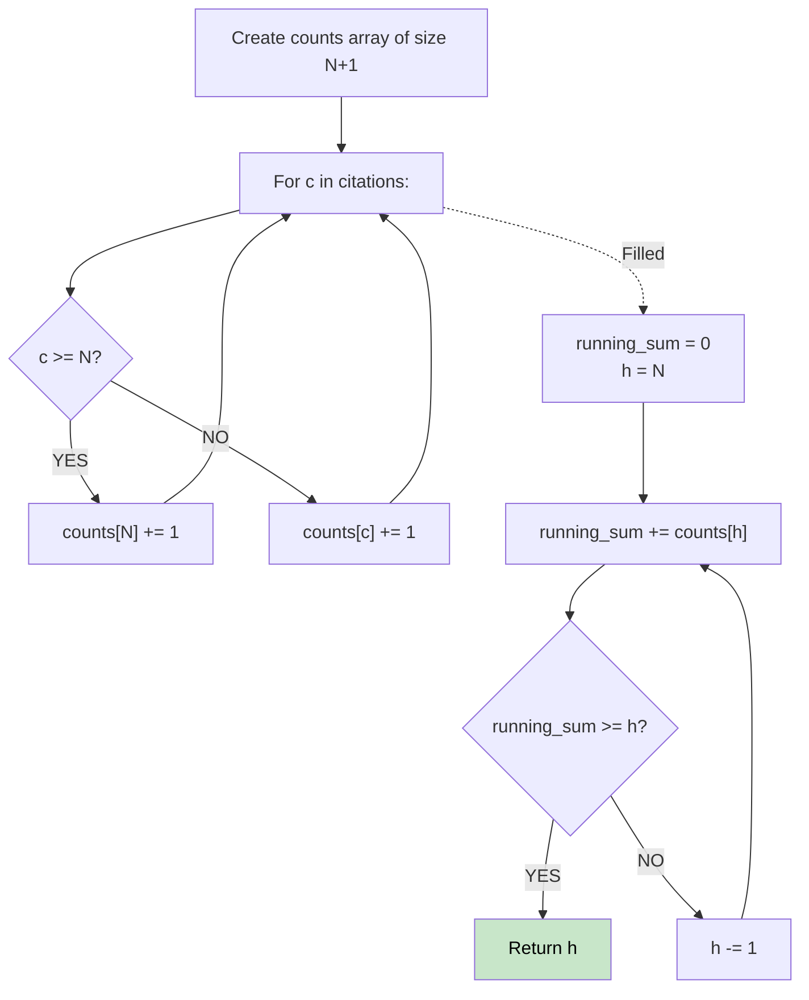

# 🚶‍♂️ Walkthrough: H-Index

## 👶 Explain Like I'm 5
A scientist's H-index is `H` if they have `H` papers that each have at least `H` citations.
If a scientist wrote 5 papers, their maximum possible H-index is 5. Even if one paper has 1,000,000 citations, it doesn't help increase the H-index beyond the total number of papers they wrote!
So we make boxes labeled 0 to 5. We put each paper in the box matching its citations (and anything > 5 goes in the 5 box). Then we count down from 5, keeping a running total of papers, until the total papers is >= the box number.

## 🎯 Core Strategy
**Counting Sort (Bucket Sort)**.

1. Create a `counts` array of size `N + 1`.
2. Iterate through `citations`. If a paper has `c >= N` citations, increment `counts[N]`. Otherwise, increment `counts[c]`.
3. Keep a running sum of `papers_with_at_least_h_citations` starting at 0.
4. Iterate `h` backwards from `N` down to 0:
   - Add `counts[h]` to the running sum.
   - If the running sum is `>= h`, then `h` is the h-index! Return it.

## 🏃‍♂️ Step-by-Step Execution (Dry Run)
**Input**: `citations = [3, 0, 6, 1, 5]`
`N = 5`.

**Fill Counts**:
- 3 -> `counts[3] += 1`
- 0 -> `counts[0] += 1`
- 6 (>5) -> `counts[5] += 1`
- 1 -> `counts[1] += 1`
- 5 -> `counts[5] += 1`
`counts = [1, 1, 0, 1, 0, 2]`

**Iterate Backwards (Running Sum)**:
- `h = 5`: sum = 0 + counts[5](2) = **2**. Is 2 >= 5? NO.
- `h = 4`: sum = 2 + counts[4](0) = **2**. Is 2 >= 4? NO.
- `h = 3`: sum = 2 + counts[3](1) = **3**. Is 3 >= 3? **YES!**

Result = 3 ✅

## 📊 Visual Diagram

## 🛑 Complexity
- **Time:** $O(N)$
- **Space:** $O(N)$ for the `counts` array.
