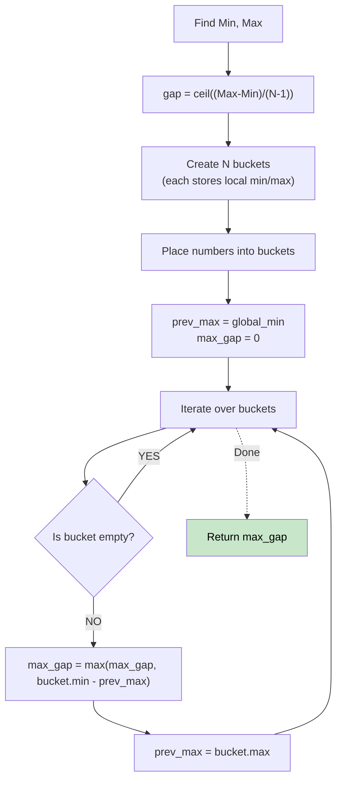

# 🚶‍♂️ Walkthrough: Maximum Gap

## 👶 Explain Like I'm 5
You have a bunch of numbers and you want to find the biggest gap between them if they were sorted.
Imagine you have numbers from 1 to 100, and you have 10 numbers total. On average, the gap between numbers is about 10. The Pigeonhole Principle says that the BIGGEST gap *must* be at least 10!
So, if we group our numbers into "buckets" of size 10, we know the biggest gap will NEVER be between two numbers inside the same bucket. It will only be between the biggest number of one bucket and the smallest number of the next!

## 🎯 Core Strategy
**Bucket Sort / Pigeonhole Principle**.

1. Find the `min_val` and `max_val` in the array.
2. The minimum possible max-gap is `gap = ceil((max_val - min_val) / (N - 1))`.
3. Create an array of `N` buckets. Each bucket only needs to store its own `min` and `max`.
4. Place every number into a bucket: `index = (num - min_val) // gap`. Update the bucket's local min/max.
5. Finally, iterate through the buckets. Skip empty ones. For a non-empty bucket, the gap is its `min` minus the `max` of the previous non-empty bucket. Track the maximum gap found.

## 🏃‍♂️ Step-by-Step Execution (Dry Run)
**Input**: `nums = [3, 6, 9, 1]`
`N = 4`. `min = 1`, `max = 9`.

**Calculate Gap**:
`gap = ceil((9 - 1) / (4 - 1)) = ceil(8 / 3) = 3`.

**Buckets (store [min, max])**:
- 3: `idx = (3 - 1) // 3 = 0`. Bucket 0 updates to `[3, 3]`.
- 6: `idx = (6 - 1) // 3 = 1`. Bucket 1 updates to `[6, 6]`.
- 9: `idx = (9 - 1) // 3 = 2`. Bucket 2 updates to `[9, 9]`.
- 1: `idx = (1 - 1) // 3 = 0`. Bucket 0 updates to `[1, 3]`.
`buckets = [ [1,3], [6,6], [9,9], empty ]`

**Check Gaps**:
- `prev_max = 1` (starting with absolute min).
- Bucket 0: gap = `1 - 1 = 0`. `prev_max` = 3.
- Bucket 1: gap = `6 - 3 = 3`. `prev_max` = 6. (Max gap = 3)
- Bucket 2: gap = `9 - 6 = 3`. `prev_max` = 9. (Max gap = 3)

Result = 3 ✅

## 📊 Visual Diagram

## 🛑 Complexity
- **Time:** $O(N)$
- **Space:** $O(N)$ to store the buckets.
