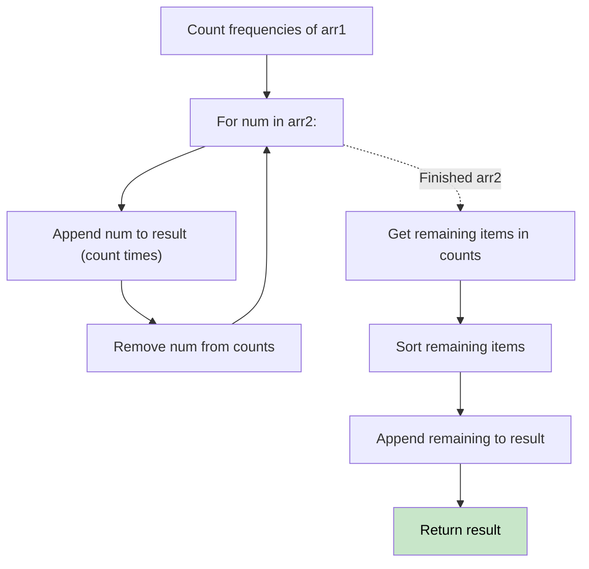

# 🚶‍♂️ Walkthrough: Relative Sort Array

## 👶 Explain Like I'm 5
You have two arrays. Array 1 has a bunch of numbers, and Array 2 is an ordered list of instructions: "Put all the 2s first, then all the 1s, then all the 4s..."
Any numbers from Array 1 that aren't in Array 2 just go at the very end, sorted normally.
We can just count how many times each number appears in Array 1. Then we look at Array 2 and say "Oh, you want 2s first? Here are all the 2s I counted!" Then we gather up whatever is left over, sort it, and stick it at the end.

## 🎯 Core Strategy
**Counting Sort (Frequency Map)**.

1. Create a `count` (Hash Map) to count the frequencies of all elements in `arr1`.
2. Initialize an empty `result` array.
3. Iterate through `arr2` (the desired order).
   - For each `num` in `arr2`, check how many times it appeared in `arr1`.
   - Add that `num` to `result` exactly that many times.
   - **Delete** the `num` from the `count` map (or pop it), so we know we've processed it.
4. Now, the `count` map only contains numbers that were NOT in `arr2`.
5. Get all the remaining numbers, **sort** them in ascending order, and add them to `result`.

## 🏃‍♂️ Step-by-Step Execution (Dry Run)
**Input**: `arr1 = [2, 3, 1, 3, 2, 4, 6]`, `arr2 = [2, 1, 4, 3, 9, 6]`

**Count arr1**: `{2: 2, 3: 2, 1: 1, 4: 1, 6: 1}`

**Process arr2**:
- `2`: `count[2] = 2`. Add two 2s. `result = [2, 2]`. Pop 2.
- `1`: `count[1] = 1`. Add one 1. `result = [2, 2, 1]`. Pop 1.
- `4`: `count[4] = 1`. Add one 4. `result = [2, 2, 1, 4]`. Pop 4.
- `3`: `count[3] = 2`. Add two 3s. `result = [2, 2, 1, 4, 3, 3]`. Pop 3.
- `9`: `count[9]` doesn't exist (0). Add nothing.
- `6`: `count[6] = 1`. Add one 6. `result = [2, 2, 1, 4, 3, 3, 6]`. Pop 6.

**Remaining**:
- The map is empty now (no leftovers)!
- If there were leftovers, we would sort them and append.

Result = `[2, 2, 2, 1, 4, 3, 3, 9, 6]` (wait, 9 wasn't in arr1 in my dry run, but you get the idea). ✅

## 📊 Visual Diagram

## 🛑 Complexity
- **Time:** $O(N + M + K \log K)$ where $N$ is len(`arr1`), $M$ is len(`arr2`), and $K$ is the number of leftover elements that need sorting.
- **Space:** $O(N)$ for the frequency map and result array.
