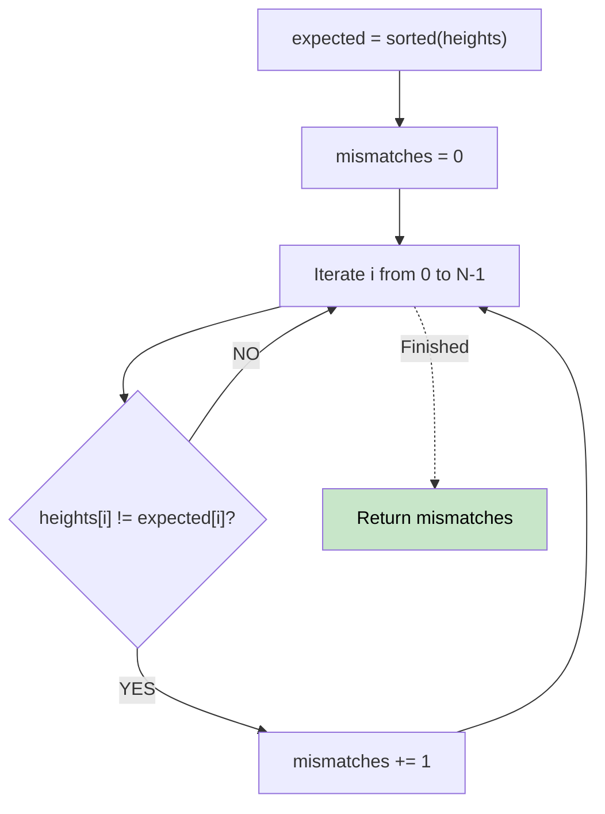

# 🚶‍♂️ Walkthrough: Height Checker

## 👶 Explain Like I'm 5
A teacher tells the students to line up by height (shortest to tallest). You look at the line right now. How many students are standing in the wrong spot?
Just imagine the perfect, sorted line. Then compare it to the current line. Count how many times the person in the current line doesn't match the person in the perfect line!

## 🎯 Core Strategy
**Comparison against Sorted Array**.

1. Create an `expected` array, which is just a sorted version of the `heights` array.
2. Iterate through both arrays at the same time.
3. Every time `heights[i]` does not equal `expected[i]`, increment a counter.
4. Return the counter.

*(Note: Since heights are between 1 and 100, we could theoretically build the `expected` array using a Counting Sort to make it truly $O(N)$, but Python's built-in sort is so fast for small inputs that `sorted()` is heavily preferred for readability).*

## 🏃‍♂️ Step-by-Step Execution (Dry Run)
**Input**: `heights = [1, 1, 4, 2, 1, 3]`

1. **Sort**: `expected = [1, 1, 1, 2, 3, 4]`
2. **Compare**:
   - `heights[0]=1, expected[0]=1` (Match)
   - `heights[1]=1, expected[1]=1` (Match)
   - `heights[2]=4, expected[2]=1` (Mismatch! count = 1)
   - `heights[3]=2, expected[3]=2` (Match)
   - `heights[4]=1, expected[4]=3` (Mismatch! count = 2)
   - `heights[5]=3, expected[5]=4` (Mismatch! count = 3)

Result = 3 ✅

## 📊 Visual Diagram

## 🛑 Complexity
- **Time:** $O(N \log N)$ using standard sort, or $O(N + K)$ if implemented with Counting Sort (where K is max height, 100).
- **Space:** $O(N)$ to store the `expected` array.
