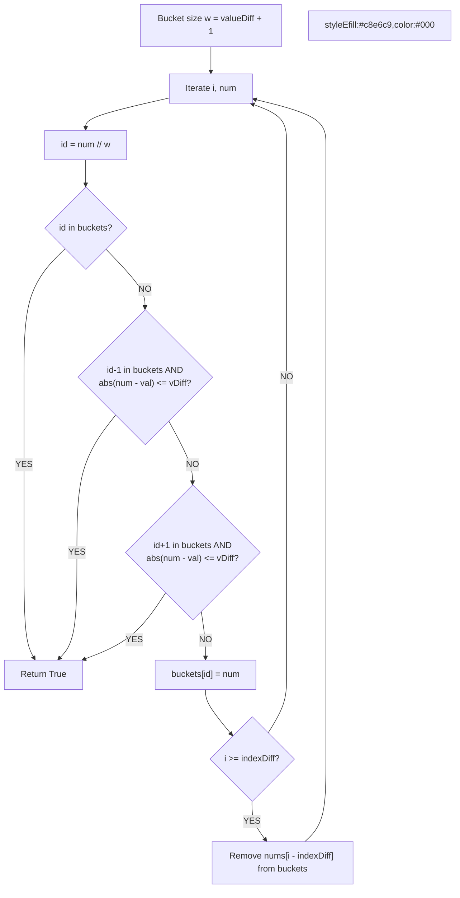

# 🚶‍♂️ Walkthrough: Contains Duplicate III

## 👶 Explain Like I'm 5
You want to know if there are two numbers that are close in value (difference $\le$ `valueDiff`) AND close in position (distance $\le$ `indexDiff`).
Instead of comparing every number to every other nearby number (too slow), we use "Buckets". If `valueDiff` is 3, we create buckets of size 4: Bucket 0 holds 0,1,2,3. Bucket 1 holds 4,5,6,7.
If two numbers fall into the *same* bucket, they are definitely close! If they fall into *adjacent* buckets, we just do a quick check. We use a sliding window so our buckets only ever hold numbers that are close in position!

## 🎯 Core Strategy
**Bucket Sort + Sliding Window**.

1. Bucket size `w = valueDiff + 1`. A number `num` belongs to bucket `num // w`.
2. Maintain a Hash Map `buckets` where the key is the `bucket_id` and the value is the `num`.
3. Iterate through `nums` with index `i`:
   - Find its `bucket_id`.
   - If `bucket_id` is already in `buckets`, we found a match! Return True.
   - Check the left adjacent bucket (`bucket_id - 1`). If it's there AND the absolute difference is $\le$ `valueDiff`, return True.
   - Check the right adjacent bucket (`bucket_id + 1`). If it's there AND difference $\le$ `valueDiff`, return True.
   - Add `num` to `buckets[bucket_id]`.
   - Maintain the sliding window: if `i >= indexDiff`, remove the number that just slid out of the window (`nums[i - indexDiff]`) from its bucket!
4. Return False if loop finishes.

## 🏃‍♂️ Step-by-Step Execution (Dry Run)
**Input**: `nums = [1, 5, 9, 1]`, `indexDiff = 2`, `valueDiff = 3`
Bucket size `w = 4`.

| i | num | bucket_id (num // 4) | Action | Buckets State | Window Maintenance (i >= 2) |
|---|---|---|---|---|---|
| 0 | 1 | 0 | Bucket 0 empty. Adjacent -1, 1 empty. Add to bucket. | `{0: 1}` | - |
| 1 | 5 | 1 | Bucket 1 empty. Adj 0 has `1`. `abs(5 - 1) = 4 > 3`. Adj 2 empty. Add. | `{0: 1, 1: 5}` | - |
| 2 | 9 | 2 | Bucket 2 empty. Adj 1 has `5`. `abs(9 - 5) = 4 > 3`. Adj 3 empty. Add. | `{0: 1, 1: 5, 2: 9}` | Remove `nums[0]=1` from bucket 0. `{1: 5, 2: 9}` |
| 3 | 1 | 0 | Bucket 0 empty. Adj -1, 1 (has 5). `abs(1-5)=4 > 3`. Add. | `{1: 5, 2: 9, 0: 1}` | Remove `nums[1]=5` from bucket 1. `{2: 9, 0: 1}` |

Returns **False** ✅ (The 1s are too far apart: indices 0 and 3, diff is 3 > indexDiff 2).

## 📊 Visual Diagram

## 🛑 Complexity
- **Time:** $O(N)$ — O(1) bucket lookups per element.
- **Space:** $O(\min(N, K))$ — where K is `indexDiff`, since the hash map never stores more than K elements.
