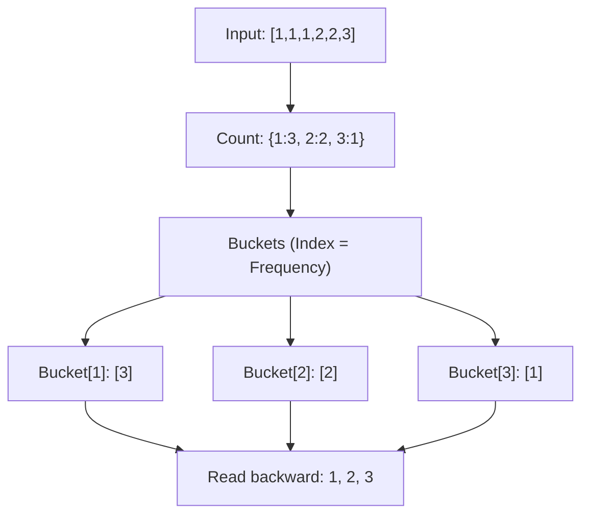

# Pattern 35: Linear Sorting Algorithm

## 👶 Explain Like I'm 5

Usually, sorting things takes some time. If you use the best general sorting methods
(like Merge Sort or Quick Sort), it takes `O(N log N)` time.
But what if I ask you to sort 1 million student grades, and you know the grades
can ONLY be between 0 and 100?
Instead of comparing grades to each other, you can just make 101 buckets (one for each grade),
drop the grades into the right bucket, and then read the buckets from 0 to 100!
You just sorted 1 million items instantly! That's **Linear Sorting**.

---

## 🧩 Core Idea & Pattern Detection

Linear Sorting avoids comparing elements directly. It exploits the **properties**
of the data (like bounded ranges or frequencies) to sort in `O(N)` time.

### The Big Three:
1. **Counting Sort**: When the range of numbers `K` is small. Count frequencies, then recreate the array. Time: `O(N + K)`.
2. **Bucket Sort**: Group elements into "buckets" (e.g. by frequency, or by value ranges). Good when data is evenly distributed or bounded.
3. **Radix Sort**: Sort by digits (1s place, 10s place, 100s place). Time: `O(d * N)` where `d` is max digits.

### When to use it:
- Finding the top K frequent elements (Bucket Sort by frequency).
- Sorting an array where values are small (like `0, 1, 2` for Dutch National Flag).
- Finding the maximum gap between sorted elements in O(N).
- Keywords: "sort in O(n) time", "bounded range", "frequent".

---

## 🔧 Visual Anatomy

Bucket Sort by Frequency (e.g., Top K Frequent Elements):

---

## ⏱️ Complexity Analysis

| Algorithm | Time | Space | Note |
|-----------|------|-------|------|
| Counting Sort | O(N + K) | O(K) | `K` is max value. |
| Bucket Sort | O(N + K) | O(N + K)| `K` is number of buckets. |
| Radix Sort | O(d * (N+b)) | O(N + b) | `d`=digits, `b`=base (10). |

---

## ✅ Problems in This Pattern

| # | Problem | Difficulty | LeetCode |
|---|---------|------------|----------|
| 1 | Sort Colors (Counting / DNF) | Medium | #75 |
| 2 | Top K Frequent Elements | Medium | #347 |
| 3 | H-Index (Counting Sort) | Medium | #274 |
| 4 | Maximum Gap (Radix/Bucket) | Hard | #164 |
