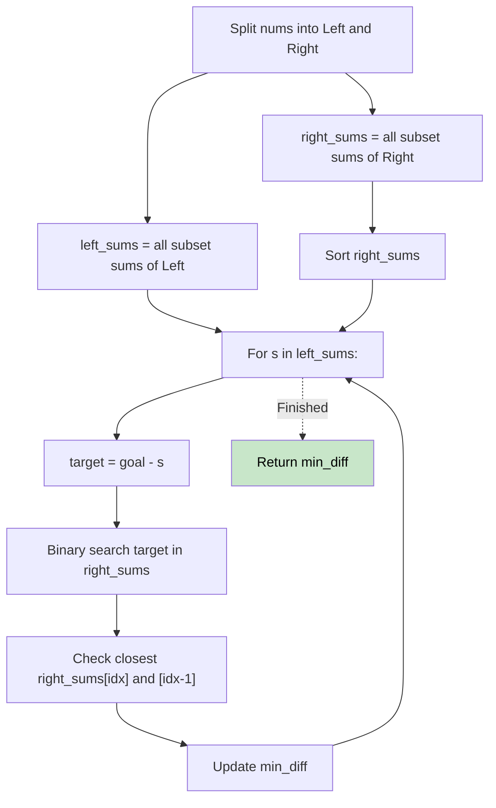

# 🚶‍♂️ Walkthrough: Closest Subsequence Sum

## 👶 Explain Like I'm 5
You have up to 40 numbers. You want to pick some of them so their sum is as close to a `goal` number as possible.
Checking every combination of 40 numbers would take 1 trillion operations! That's too slow.
Instead, we split the 40 numbers into two groups of 20. We find every possible sum for the first group (about 1 million sums). We find every possible sum for the second group (another 1 million sums). Then, for every sum in the first group, we just look up the best matching sum in the second group to reach our goal!

## 🎯 Core Strategy
**Meet in the Middle**.

1. **Split**: Divide the array into two halves: `left` and `right`.
2. **Generate Subset Sums**: Create a helper function that returns all possible subset sums for an array. Apply this to both `left` and `right` to get `left_sums` and `right_sums`.
3. **Sort**: Sort `right_sums`.
4. **Binary Search**: Iterate through every sum `s` in `left_sums`.
   - Our target value from the right side is `target = goal - s`.
   - Use Binary Search (`bisect_left`) on `right_sums` to find the value closest to `target`.
   - Check the element exactly at the index found, and the element right before it (since `bisect_left` might return an index where the value is slightly larger than `target`, so the previous index might be a closer match).
   - Update `min_diff` with the absolute difference `abs(goal - (s + right_match))`.
   - If `min_diff` becomes 0, return 0 immediately!

## 🏃‍♂️ Step-by-Step Execution (Dry Run)
**Input**: `nums = [5, -7, 3, 5]`, `goal = 6`
Split into `left = [5, -7]` and `right = [3, 5]`.

**Left Sums**:
- Empty: 0
- [5]: 5
- [-7]: -7
- [5, -7]: -2
`left_sums = [0, 5, -7, -2]`

**Right Sums** (Sorted):
- Empty: 0
- [3]: 3
- [5]: 5
- [3, 5]: 8
`right_sums = [0, 3, 5, 8]`

**Binary Search**:
- `s = 0`: target = 6 - 0 = 6. Closest in `right_sums` is 5 or 8. Try 5. Sum = 0+5=5. Diff = 1.
- `s = 5`: target = 6 - 5 = 1. Closest in `right_sums` is 0 or 3. Try 0. Sum = 5+0=5. Diff = 1.
- `s = -7`: target = 6 - (-7) = 13. Closest in `right_sums` is 8. Sum = -7+8=1. Diff = 5.
- `s = -2`: target = 6 - (-2) = 8. Closest in `right_sums` is 8. Sum = -2+8=6. Diff = 0! (Perfect match).

Result = 0 ✅

## 📊 Visual Diagram

## 🛑 Complexity
- **Time:** $O(2^{N/2} \log(2^{N/2}))$ — For $N=40$, $2^{20} \approx 10^6$. Sorting and binary searching takes roughly $20 \times 10^6$ operations. Very fast!
- **Space:** $O(2^{N/2})$ to store the generated sums.
