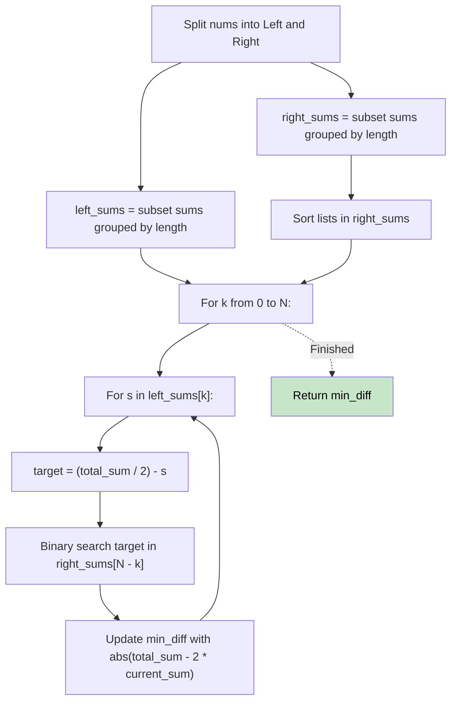

# 🚶‍♂️ Walkthrough: Partition Array Into Two Arrays to Minimize Sum Difference

## 👶 Explain Like I'm 5
You have an array of 2N numbers. You need to split them into two equal halves (N numbers each) so that the sums of the two halves are as close as possible.
This is like "Closest Subsequence Sum", but with a strict rule: you MUST pick exactly N elements!
So, when we split the array into a left part and a right part, if we pick `k` elements from the left, we MUST pick exactly `N - k` elements from the right to make a full team of N!

## 🎯 Core Strategy
**Meet in the Middle (Grouped by Size)**.

1. `total_sum = sum(nums)`. We want our subset sum to be as close to `target = total_sum / 2` as possible.
2. Split `nums` into `left` and `right` (size N each).
3. Generate all subset sums for `left`, **grouped by the number of elements picked** (`k`). Store them in a dictionary mapping `k` to a list of sums.
4. Do the same for `right`. Sort the lists in `right` for binary searching.
5. For every possible size `k` (from 0 to N):
   - For every sum `s` in `left_sums[k]`:
     - We picked `k` elements from `left`. We need `N - k` elements from `right`.
     - Our target value from the right side is `needed = target - s`.
     - Use Binary Search (`bisect_left`) on `right_sums[N - k]` to find the closest match.
     - Calculate the `current_sum = s + right_match`. The difference between the two halves is `abs(total_sum - 2 * current_sum)`. Update `min_diff`.

## 🏃‍♂️ Step-by-Step Execution (Dry Run)
**Input**: `nums = [3, 9, 7, 3]` (2N = 4, N = 2). `total_sum = 22`. `target = 11`.
Split: `left = [3, 9]`, `right = [7, 3]`

**Left Sums (by size)**:
- k=0: `[0]`
- k=1: `[3, 9]`
- k=2: `[12]`

**Right Sums (by size, sorted)**:
- k=0: `[0]`
- k=1: `[3, 7]`
- k=2: `[10]`

**Binary Search**:
- `k=1`: Left sums `[3, 9]`. We need `2 - 1 = 1` element from right.
  - `s = 3`: needed = 11 - 3 = 8. `right_sums[1]` is `[3, 7]`. Closest is 7. `current_sum = 3 + 7 = 10`. Diff = `abs(22 - 20) = 2`.
  - `s = 9`: needed = 11 - 9 = 2. Closest in `[3, 7]` is 3. `current_sum = 9 + 3 = 12`. Diff = `abs(22 - 24) = 2`.

Result = 2 ✅ (Partition is [3, 7] sum 10, and [9, 3] sum 12).

## 📊 Visual Diagram

## 🛑 Complexity
- **Time:** $O(N \cdot 2^N)$ — Generating grouped combinations takes a bit longer, and we binary search.
- **Space:** $O(2^N)$ — To store the grouped sums.
