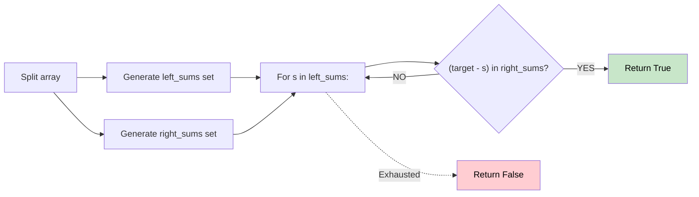

# 🚶‍♂️ Walkthrough: Subset Sum Equal to Target

## 👶 Explain Like I'm 5
You have an array of up to 40 numbers. Is there any combination of these numbers that adds up exactly to a `target`?
Checking all combinations takes way too long. But checking combinations of 20 numbers is super fast!
So we split the array in half. We find all possible sums for the left half, and all possible sums for the right half.
Then we just check: for any sum `s` on the left, does the right half have a sum exactly equal to `target - s`?

## 🎯 Core Strategy
**Meet in the Middle**.

1. Split `nums` into `left` and `right`.
2. Write a helper function to generate a `set` of all possible subset sums for a given array.
3. Get `left_sums` (a set) and `right_sums` (a set).
4. Iterate through `s` in `left_sums`. If `target - s` is in `right_sums` (which is an O(1) set lookup!), return True immediately.
5. If we check everything and find nothing, return False.

## 🏃‍♂️ Step-by-Step Execution (Dry Run)
**Input**: `nums = [2, 3, 7, 8, 10]`, `target = 11`
Split: `left = [2, 3]`, `right = [7, 8, 10]`

**Left Sums**:
- `0, 2, 3, 5` (as a set)

**Right Sums**:
- `0, 7, 8, 10, 15, 17, 18, 25` (as a set)

**Check**:
- `s = 0`: target - s = 11. Is 11 in right_sums? NO.
- `s = 2`: target - s = 9. Is 9 in right_sums? NO.
- `s = 3`: target - s = 8. Is 8 in right_sums? YES!

Return **True**! ✅ (The subset is `[3, 8]`).

## 📊 Visual Diagram

## 🛑 Complexity
- **Time:** $O(2^{N/2})$ — Generating sums takes $O(2^{N/2})$. Set lookup is O(1), and we do it $2^{N/2}$ times.
- **Space:** $O(2^{N/2})$ to store the sets of sums.
