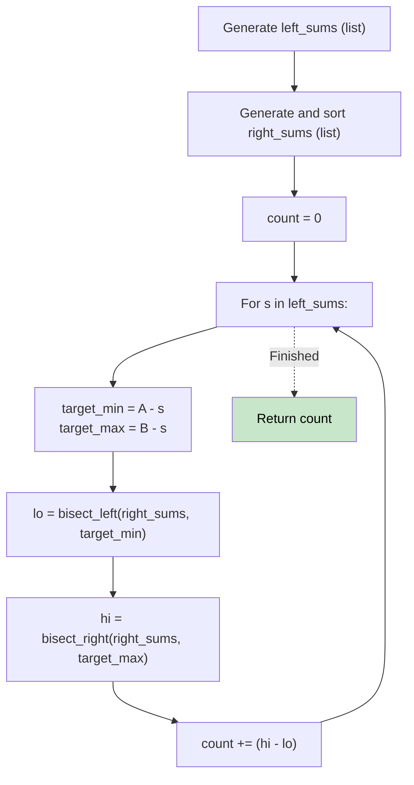

# 🚶‍♂️ Walkthrough: Subsets Having Sum Between A and B

## 👶 Explain Like I'm 5
You want to count how many combinations of numbers add up to a sum that falls perfectly between `A` and `B` (inclusive).
We split the array in half and find all possible sums for both halves.
For every sum `s` on the left side, we need a sum `r` from the right side such that `A <= s + r <= B`.
This means we need `A - s <= r <= B - s`.
Since we sort the right side, we can just use Binary Search to quickly find how many numbers fall in that range!

## 🎯 Core Strategy
**Meet in the Middle + Range Binary Search**.

1. Split `nums` into `left` and `right`.
2. Generate all subset sums for both halves (`left_sums`, `right_sums`). This time they should be arrays/lists (not sets, because we need to count duplicates!).
3. Sort `right_sums`.
4. Initialize `count = 0`.
5. For `s` in `left_sums`:
   - We need values in `right_sums` between `A - s` and `B - s`.
   - `lo = bisect_left(right_sums, A - s)` gives the index of the first valid number.
   - `hi = bisect_right(right_sums, B - s)` gives the index right after the last valid number.
   - The number of valid combinations using this `s` is exactly `hi - lo`!
   - Add this to `count`.

## 🏃‍♂️ Step-by-Step Execution (Dry Run)
**Input**: `nums = [1, 2, 3]`, `A = 3`, `B = 5`
Split: `left = [1]`, `right = [2, 3]`

**Left Sums**:
- `[0, 1]`

**Right Sums (Sorted)**:
- `[0, 2, 3, 5]`

**Binary Search**:
- `s = 0`: We need `r` between 3 and 5.
  - `lo = bisect_left(3)` -> index 2 (value 3)
  - `hi = bisect_right(5)` -> index 4 (past end)
  - `count += 4 - 2 = 2` (The matches are 3 and 5).
- `s = 1`: We need `r` between 2 and 4.
  - `lo = bisect_left(2)` -> index 1 (value 2)
  - `hi = bisect_right(4)` -> index 3 (value 5)
  - `count += 3 - 1 = 2` (The matches are 2 and 3).

Total `count` = 4 ✅ (Matches: `{3}`, `{2, 3}`, `{1, 2}`, `{1, 3}`).

## 📊 Visual Diagram

## 🛑 Complexity
- **Time:** $O(2^{N/2} \log(2^{N/2}))$
- **Space:** $O(2^{N/2})$
