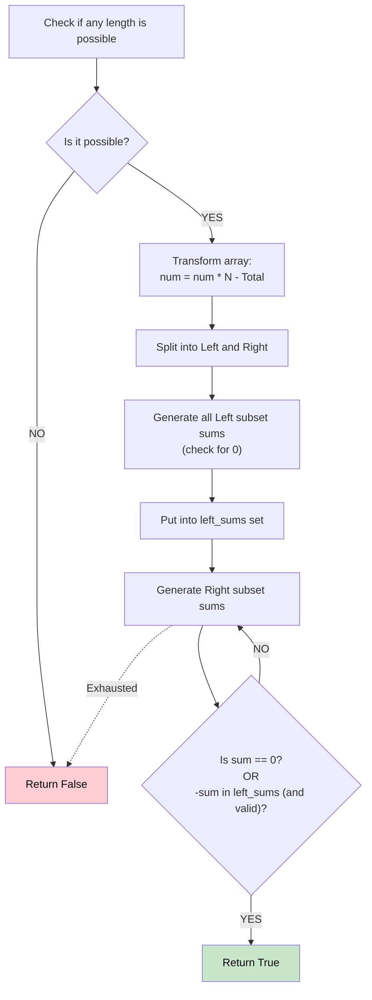

# 🚶‍♂️ Walkthrough: Split Array With Same Average

## 👶 Explain Like I'm 5
Can you split a group of numbers into two smaller groups so that the *average* of both groups is exactly the same?
If both groups have the same average, that average MUST also be the average of the whole group!
So the problem becomes: can we find a group of numbers that adds up exactly to `(total_average * group_size)`?
Since finding exact sums of subsets takes a long time, we can tweak the numbers so the total average is exactly 0. Then we just need to find a group that adds up to 0! To do it fast, we split the array in half and use Meet in the Middle.

## 🎯 Core Strategy
**Math Transformation + Meet in the Middle**.

1. **Quick Filter**: If `sum(A) = average(Total) * len(A)`, then `sum(A) = total_sum * len(A) / N`. For this to be an integer, `(total_sum * len(A))` must be divisible by `N`. We can quickly check all possible lengths `1` to `N/2` to see if a split is even mathematically possible.
2. **Transformation**: To avoid dealing with fractions and specific sizes, subtract the `average` from every number. Now we just need to find a non-empty subset that sums to 0!
   - To avoid floating point math entirely, multiply everything by `N`: `nums[i] = nums[i] * N - total_sum`.
3. **Meet in the Middle**:
   - Split the transformed array into `left` and `right`.
   - Find all subset sums for `left`. If any sum is 0, return True! Add all sums to a set `left_sums`.
   - Find all subset sums for `right`. If any sum is 0, return True!
   - If a `right` sum isn't 0, but its opposite (`-current_sum`) exists in `left_sums`, we found a match that sums to 0! Return True.
   - *Careful*: We must ensure we don't accidentally pick ALL elements from `left` AND ALL elements from `right` simultaneously, because that's just the entire original array (which naturally sums to 0) and we need to split it into TWO non-empty arrays.

## 🏃‍♂️ Step-by-Step Execution (Dry Run)
**Input**: `nums = [1, 2, 3, 4, 5, 6, 7, 8]` (N = 8, total = 36)

**Quick Filter**: Can we find a length `k` such that `(36 * k) % 8 == 0`?
For k=2, `36*2 = 72`, divisible by 8! So it's possible.

**Transformation**:
`A[i] = nums[i] * 8 - 36`
`A = [-28, -20, -12, -4, 4, 12, 20, 28]`

**Meet in the Middle**:
Split: `left = [-28, -20, -12, -4]`, `right = [4, 12, 20, 28]`

**Left Sums**:
- Includes sums like -4, -12, -16...
- We put all 2^4 = 16 sums into a set.

**Right Sums**:
- We generate subsets of `right`.
- e.g., if we pick `[4]`, sum is 4. Is `-4` in `left_sums`? YES!
- `[-4]` from left and `[4]` from right forms a valid subset!

Result = **True** ✅ (The split could be `[4, 5]` and `[1, 2, 3, 6, 7, 8]`).

## 📊 Visual Diagram

## 🛑 Complexity
- **Time:** $O(2^{N/2})$ — Generating subsets for half the array.
- **Space:** $O(2^{N/2})$ — Storing the left sums in a set.
