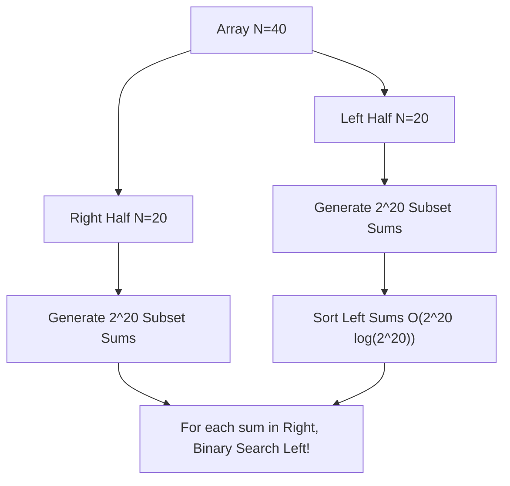
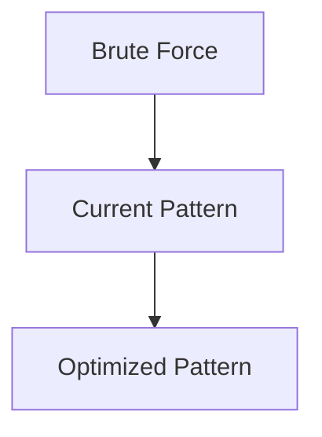

# Pattern 36: Meet in the Middle

## 👶 Explain Like I'm 5

Imagine trying to guess a combination lock with 40 dials.
Checking every possible combination (`2^40` or 1,000,000,000,000) would take forever!
Instead, what if you and your friend split the work?
You write down every possible combo for the first 20 dials (only 1,000,000 options).
Your friend writes down every possible combo for the last 20 dials (also 1,000,000 options).
Then, you sort your list, and for each combo your friend has, you quickly Binary Search
your list to find the perfect match!
You just turned 1 Trillion operations into a couple million. That's **Meet in the Middle**!

---

## 🧩 Core Idea & Pattern Detection

**Meet in the Middle** is a search technique used when the input size `N` is just a bit
too large for a pure O(2^N) brute-force Backtracking search (e.g., `N` is around 30-40),
but small enough that O(2^(N/2)) is completely feasible.

### How it works:
1. Divide the input array into two equal halves.
2. Generate all possible subset sums (or combinations) for the Left Half.
3. Generate all possible subset sums (or combinations) for the Right Half.
4. Sort the Left Half results.
5. Iterate through the Right Half results, and use Binary Search (`bisect`) on the
   Left Half to find the value that brings you closest to your target.

### When to use it:
- Finding combinations or subset sums.
- `N` is between 20 and 40. (Too big for O(2^N), too small for O(N^3) DP).
- Keywords: "Subset sum", "Closest to target", "Partition array into two".

---

## 🔧 Visual Anatomy

Splitting `N=40` to find a Target Sum:



---

## ⏱️ Complexity Analysis

| Scenario | Brute Force Time | Meet in Middle Time |
|----------|------------------|---------------------|
| Subset Sum N=40 | O(2^40) = 1 Trillion! | O(2^20 * 20) ≈ 20 Million |

Space Complexity is typically O(2^(N/2)) to store the combinations.

---

## ✅ Problems in This Pattern

| # | Problem | Difficulty | LeetCode |
|---|---------|------------|----------|
| 1 | Closest Subsequence Sum | Hard | #1755 |
| 2 | Partition Array Into Two Arrays to Minimize Sum Difference | Hard | #2035 |


## 📦 Prerequisite Data Structures
- Basic understanding of Arrays, Hash Maps, and Meet in the Middle fundamentals.


## 🔍 How to Spot This Pattern (Signal Detection)
- **Keywords**: "minimize", "maximize", "combinations", "shortest", "longest".
- **Problem Constraints**: Indicates whether O(N), O(N log N), or O(2^N) is acceptable.


## 🔧 Algorithmic Anatomy
### Variable Table
| Variable | Purpose |
|---|---|
| `result` | Stores the final answer |
| `visited` | Tracks seen elements to avoid cycles or re-processing |

### Step-by-Step Recipe
1. Initialize data structures.
2. Iterate through the input.
3. Update state based on current element.
4. Return result.

### Loop Invariants
- At the start of each iteration, the state reflects the optimal solution up to the previous element.

### DOs and DON'Ts
- **DO**: Trace through an example manually before coding.
- **DON'T**: Forget edge cases like empty inputs.


## 🏗️ Template / Boilerplate Code
```python
def solve_meet_in_the_middle(nums):
    # Initialize state
    result = 0
    for num in nums:
        # Process num
        pass
    return result
```


## 🔄 Brute Force → Optimal Evolution
- **Brute Force**: Try all possibilities (often O(N^2) or O(2^N)).
- **Optimal**: Use this pattern to reduce redundant work to O(N) or O(N log N).


## 🔗 Pattern Connections



## ⚠️ Common Mistakes & Pitfalls
- Off-by-one errors in loop boundaries.
- Not handling negative numbers or zero correctly.
- Forgetting to update the result variable inside the loop.


## 🎤 Interview Communication Guide
1. **Acknowledge**: "This looks like a variation of the classic problem..."
2. **Propose**: "I'll use this pattern because it optimizes the brute force O(N^2) to O(N)."
3. **Execute**: Write clean, modular code.
4. **Review**: Trace with the provided edge case.


## 🧪 Self-Test Questions
<details>
<summary>When should you use this pattern?</summary>
When the problem asks for optimal subarrays, combinations, or specific mathematical properties.
</details>
<details>
<summary>What is the typical time complexity?</summary>
Usually O(N) or O(N log N), depending on sorting or data structure overhead.
</details>
