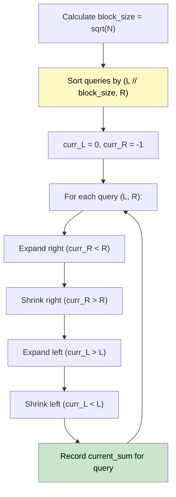

# 🚶‍♂️ Walkthrough: Range Sum Query (MO's Algorithm Intro)

## 👶 Explain Like I'm 5
You have an array of numbers and someone keeps asking you: "What is the sum of the numbers from index L to index R?"
You *could* use a Prefix Sum to answer this instantly. But we want to learn a technique called MO's Algorithm!
Imagine you have a sliding window over the array. If the next question asks for a range that's very close to your current window, you just slide the edges of your window left or right a little bit, adding or subtracting numbers as you go, instead of recalculating from scratch! To make this fast, we sort the questions in a special way so the window never has to move too far between questions.

## 🎯 Core Strategy
**MO's Algorithm (Square Root Decomposition)**.

1. **Block Size**: Divide the array into blocks of size $\sqrt{N}$.
2. **Sort Queries**: Sort the queries so that queries starting in the same block are grouped together. If they start in the same block, sort them by their ending index `R`.
   - Primary sort key: `L // block_size`
   - Secondary sort key: `R`
3. **Sliding Window**: Keep two pointers, `curr_L` and `curr_R`, representing your current window, and a `current_sum`.
4. **Process Queries**: For each query `(L, R)`:
   - While `curr_R < R`: expand right, add `nums[curr_R + 1]`.
   - While `curr_R > R`: shrink right, remove `nums[curr_R]`.
   - While `curr_L > L`: expand left, add `nums[curr_L - 1]`.
   - While `curr_L < L`: shrink left, remove `nums[curr_L]`.
5. Store the `current_sum` for the query's original index.

## 🏃‍♂️ Step-by-Step Execution (Dry Run)
**Input**: `nums = [1, 1, 2, 1, 3, 4, 5, 2, 8]`, `queries = [[0, 4], [1, 3], [2, 4]]`
N = 9. Block size = $\sqrt{9} = 3$.

**Sort Queries**:
1. `[0, 4]` -> Block 0 (0//3). R=4.
2. `[1, 3]` -> Block 0 (1//3). R=3.
3. `[2, 4]` -> Block 0 (2//3). R=4.
Sorted order: `[1, 3]`, `[0, 4]`, `[2, 4]`. (Wait, 3 comes before 4, so `[1, 3]` is first!).

**Process**:
- Start: `curr_L = 0, curr_R = -1`, `sum = 0`.
- **Query `[1, 3]`**:
  - `curr_R` goes up to 3: add `nums[0..3] = [1, 1, 2, 1]`. `sum = 5`.
  - `curr_L` goes up to 1: remove `nums[0] = 1`. `sum = 4`.
  - Result for `[1, 3]` is 4.
- **Query `[0, 4]`**:
  - `curr_R` goes up to 4: add `nums[4] = 3`. `sum = 7`.
  - `curr_L` goes down to 0: add `nums[0] = 1`. `sum = 8`.
  - Result for `[0, 4]` is 8.
- **Query `[2, 4]`**:
  - `curr_R` is already 4.
  - `curr_L` goes up to 2: remove `nums[0]=1, nums[1]=1`. `sum = 6`.
  - Result for `[2, 4]` is 6.

Result array = `[8, 4, 6]` (in original query order). ✅

## 📊 Visual Diagram

## 🛑 Complexity
- **Time:** $O(Q \log Q + Q \sqrt{N})$ — The right pointer moves at most $N$ times per block, totaling $B \times N = \sqrt{N} \times N$ over all queries. The left pointer moves at most $\sqrt{N}$ per query, totaling $Q \sqrt{N}$.
- **Space:** $O(Q)$ to store queries and results.
